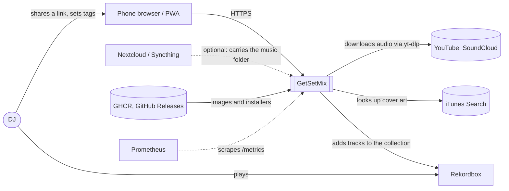
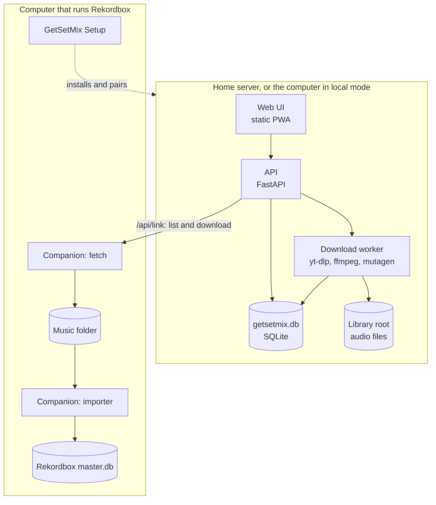
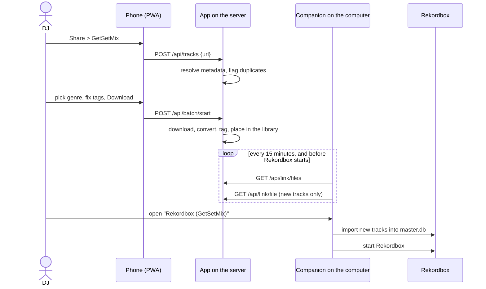

# GetSetMix architecture

This document is the overview: what GetSetMix is made of, how the parts
talk, where it runs, and the decisions that shape it. It follows
[arc42](https://arc42.org), with the sections that don't apply left out.
Detail lives in the design docs under [`docs/design/`](design/), one per
main module, and measured results live under [`docs/research/`](research/).

System-level decisions are recorded once, in the
[decision log](#9-decision-log). Design docs link to it instead of repeating
it.

## 1. Introduction and goals

GetSetMix gets tracks into a DJ's Rekordbox collection without a session at
the computer. The DJ shares a YouTube or SoundCloud link from the phone, sets
the metadata with one thumb, and finds the track downloaded, tagged and
already in Rekordbox when they sit down to play.

The roadmap ([#12](https://github.com/Fre0Grella/getsetmix/issues/12)) grows
it, stage by stage, into a suite for managing a DJ library:

| Stage | What it adds | State |
|---|---|---|
| 1. Ingest | share a link, set the tags, download, deliver to Rekordbox | built |
| 2. Library | see and fix every track: search, edit tags, delete | design ([#19](https://github.com/Fre0Grella/getsetmix/issues/19)) |
| 3. Metadata | batch tag editing and saved cleanup rules | design ([#20](https://github.com/Fre0Grella/getsetmix/issues/20)) |
| 4. Analysis | BPM/key match and sort, similar tracks, scatter map, graph playlist, auto cue points | research spikes |

Quality goals, in order:

1. **The DJ's collection is never damaged.** Rekordbox's database holds cues,
   grids and playlists that took years to build. Anything that writes to it
   is backed up, atomic and checked.
2. **The server's copy is the backup.** Nothing done on a computer can change
   or remove it.
3. **One thumb.** Every step on the phone works one-handed, in the moment.
4. **Small.** The server runs in well under 1 GB of RAM on a home lab board;
   the companion is one file with nothing left running.

## 2. Constraints

- **Rekordbox is closed.** There is no API. The collection is an encrypted
  SQLite database (`master.db`) with an undocumented schema, and it must not
  be written while Rekordbox runs.
- **Two languages.** The app is Python (FastAPI); the companion is Go,
  because it has to be a single small executable on Windows and macOS with
  SQLCipher compiled in.
- **No build step for the UI.** Plain HTML, CSS and JavaScript, served as
  static files, installable as a PWA.
- **Platforms.** The app runs on Linux (Docker image for amd64 and arm64),
  Windows and macOS. The companion and Setup run on Windows and macOS, the
  platforms Rekordbox runs on.
- **Licenses.** The project is AGPL-3.0, and every shipped component has to
  allow commercial use ([decisions 1 and 2](#9-decision-log)).
- **Phones.** Sharing into GetSetMix needs a Web Share Target, which only
  Android browsers implement, and an HTTPS origin.

## 3. Context

| Neighbour | What crosses the boundary |
|---|---|
| DJ, through a phone or a computer browser | links in; tag edits; settings |
| YouTube, SoundCloud and anything yt-dlp supports | audio and metadata out of them, never anything in |
| iTunes Search | cover art candidates |
| Rekordbox | new rows in `master.db`, or an XML it imports |
| Nextcloud, Syncthing | optional: a music folder the DJ already syncs, which the companion only watches |
| GHCR and GitHub Releases | the Docker image, GetSetMix Setup, the companion; Watchtower or Keel pull updates |
| Prometheus | optional metrics scrape |

## 4. Solution strategy

- **One app, two places.** The same FastAPI app runs on a home server
  (always on, reachable from the phone) or on the DJ's computer in a window
  of its own (local mode). Features are built once and work in both.
- **The companion does the last step.** A small Go program on the computer
  that runs Rekordbox downloads finished tracks from the server and writes
  them into the collection. It is also GetSetMix Setup, the installer.
- **One way.** Tracks travel from the server to the computers. A computer
  never changes the server's library.
- **Nothing left running.** The companion runs right before Rekordbox starts
  (through a launcher shortcut) and on a 15-minute schedule to download; it
  is not a daemon.
- **Reuse before building.** yt-dlp downloads, ffmpeg converts, mutagen
  tags. For analysis, Rekordbox's own results (BPM, key, beat grid, phrases)
  are read before any model is run.
- **Spikes before features.** A feature whose usefulness or cost is unknown
  starts as a throwaway spike with a write-up in `docs/research/`.

## 5. Building blocks

**The app** (`app/`, Python):

| Module | Responsibility |
|---|---|
| `main.py` | API routes, auth middleware, serves the UI |
| `worker.py` | the download queue: fetch, convert, tag, place in the library |
| `metadata.py`, `ytdl.py` | resolve a link into tracks; yt-dlp options and health |
| `tagger.py` | write ID3v2.4 and FLAC tags with embedded cover |
| `naming.py` | file names from the template, sanitised |
| `rekordbox.py` | the Rekordbox XML inbox, and duplicate checks against a collection export |
| `db.py` | SQLite: staged and processed tracks, URL history, counters |
| `link.py` | `/api/link`: what paired computers may list and download |
| `config.py`, `metrics.py` | settings with env overrides; Prometheus text |
| `static/` | the UI: vanilla JavaScript, English and Italian, light and dark |

**The companion** (`companion/`, Go):

| Package | Responsibility |
|---|---|
| `setup`, `serverscript` | GetSetMix Setup: the installer window, and the scripts it sends to a home server |
| `fetch` | download new tracks from the server, once each |
| `scan`, `watch` | find files that arrived in the watched folders |
| `importer` | one safe sync into Rekordbox (see [8.1](#81-writing-to-rekordbox)) |
| `library` | reads and writes `master.db` and `masterPlaylists6.xml` |
| `audio` | reads stream facts and tags from audio files |
| `rekordbox` | finds the Rekordbox install and whether it is running |
| `install` | the launcher shortcut, autostart, the scheduled fetch |

Planned modules, each with a design doc written before it is built:

| Module | Design doc | Issue |
|---|---|---|
| Library: index, identity, changes, trash, the Library view | `docs/design/library.md` | [#19](https://github.com/Fre0Grella/getsetmix/issues/19), for [#11](https://github.com/Fre0Grella/getsetmix/issues/11) |
| Batch editing and cleanup rules | `docs/design/batch-editing.md` | [#20](https://github.com/Fre0Grella/getsetmix/issues/20) |
| Analysis | decided after the spikes | [#24](https://github.com/Fre0Grella/getsetmix/issues/24) |

## 6. Runtime

### 6.1 Get, Set, Mix with a home server

Without a home server the app runs on the computer, the DJ pastes the link
there, and the companion imports straight from the library folder. Without
the companion, the app writes a Rekordbox XML with an *Inbox* playlist that
the DJ reloads by hand.

### 6.2 One import into Rekordbox

1. Scan the watched folders. Stop if nothing is new; no database is opened.
2. Refuse to write while Rekordbox is running.
3. Read the collection, drop files it already has, probe the rest.
4. Back up `master.db` and `masterPlaylists6.xml`, write everything in one
   transaction, run SQLite's `quick_check`, and put the backup back if the
   write or the check fails.

## 7. Deployment

| Shape | What runs | Updates |
|---|---|---|
| **Just this computer** | the app as a packaged executable in its own window, with ffmpeg and Deno next to it; the companion | a new Setup download |
| **Home server, Docker** | one container from `ghcr.io/fre0grella/getsetmix`, a data volume and the music folder | Watchtower |
| **Home server, Kubernetes** | a Deployment with one replica and `Recreate`, two PVCs (data, music), a Service, an optional TLS Ingress | Keel |

In both server shapes each paired computer runs the companion, with a
scheduled `fetch` every 15 minutes. The phone needs HTTPS to install the PWA
and share into it; Setup turns it on with `tailscale serve` when the server
has Tailscale.

State on the server is SQLite on a volume, which is why there is exactly one
replica. State on the computer is the companion's folder (`companion.json`,
`state.json`, `fetched.json`, the last backup).

Releases are automatic: Conventional Commits on `main` drive semantic
versioning, the GitHub Release, the executables, Setup and the versioned
images. The companion has its own version in `companion/VERSION`.

## 8. Cross-cutting concepts

### 8.1 Writing to Rekordbox

Every write to `master.db` follows the importer's rules: never while
Rekordbox runs (checked before reading and again before writing), backup
first, one transaction, integrity check after, restore on failure. Rows
mirror what Rekordbox itself stores, including its change counters. New
kinds of write (updating tags, cue points) use the same rules.

### 8.2 One-way delivery

The server's library is the full copy. `/api/link` only lists and serves
files; a track fetched once is never fetched again, so deleting it on a
computer sticks and never reaches the server. The Library module extends the
listing with changed and deleted tracks without giving computers a way to
write.

### 8.3 Track identity

Today a track is its path: in the server's listing, in the companion's
state, and in the duplicate check before an import. That breaks on a rename
or a move, and it cannot tie an analysis result made on the computer to the
server's copy. The Library module replaces it with a hash of the audio
payload ([decision 4](#9-decision-log)).

### 8.4 Access

The app is private by default. A static token or Basic Auth protects the API
and `/metrics` when it is exposed. Each paired computer has its own link
token, read on every request, which only opens `/api/link`.

### 8.5 What may ship

Only components whose licenses allow commercial use go into the image, the
executables or Setup ([decision 2](#9-decision-log)). The check of each tool
is in `docs/research/licenses.md`
([#18](https://github.com/Fre0Grella/getsetmix/issues/18)).

### 8.6 Where tagging and analysis run

In the app, wherever it runs: on the computer in local mode, on the server
otherwise ([decision 3](#9-decision-log)). Anything a feature needs at run
time therefore has to fit the packaged Windows and macOS builds as well as
the Docker image.

### 8.7 Configuration and observability

Settings live in `<data>/config.json`, are editable in the UI, and are
overridden by `GSM_*` environment variables at boot. `/healthz` serves
probes; `/metrics` exposes job counts, durations and errors.

## 9. Decision log

| # | Date | Decision | Why | Alternatives rejected |
|---|---|---|---|---|
| 1 | 2026-11-13 | The project is licensed AGPL-3.0 (`AGPL-3.0-only`). | Self-hosting stays free and complete, and anyone who hosts a modified GetSetMix for others has to publish their changes. | Apache-2.0 or MIT: lets anyone run a closed hosted copy. A source-available license (BSL, FSL): not open source, and it conflicts with bundling GPL code. |
| 2 | 2026-11-13 | Only components whose licenses allow commercial use ship in the product. Non-commercial models may be used in a spike as a yardstick only. | A hosted offering is planned next to free self-hosting, which makes the project commercial for licensing purposes. | Shipping non-commercial models (the MTG and Essentia models, MERT): rules out the hosted offering. Letting users download them at run time: same problem for the hosted copy. |
| 3 | 2026-11-13 | Tagging and analysis run in the app, wherever it runs. When a computer and a server both exist, the computer is preferred. | Without a server the features still have to work; the computer sits next to Rekordbox's own data; a server lets the DJ do everything from the phone. | Server only: nothing works in local mode. Computer only: nothing can be done from the phone while the computer is off. |
| 4 | 2026-11-13 | A track is identified by a hash of its audio payload, skipping tag blocks. | It survives tag edits, moves and renames, never modifies a file, and gives the same answer on the server and on the computer. | An ID written into a tag: every existing file has to be rewritten, a copy carries the same ID, another tagger can strip it. The path: breaks on rename, and matching by relative path is guesswork. |
| 5 | 2026-11-13 | The first Library version does not rename files. | A rename ripples into Rekordbox's paths on every paired computer; tags are what the DJ sees. Decision 4 keeps renaming possible later. | Rename per track or in bulk from the filename template, as first proposed in #11. |
| 6 | 2026-11-13 | Roadmap scope. In: Library view, batch editing and cleanup rules, BPM/key match and sort, similar tracks, scatter map and graph playlist. To try: auto cue points. Out: online tag lookup, duplicates by audio fingerprint, identifying untagged files, genre detection. | The features in are the ones worth their cost to a DJ; each uncertain one starts with a spike. Tag lookup and fingerprint services add terms and rate limits for doubtful matches on this kind of library; genre is already one tap at ingest. | Building the whole list in #12. |

The log starts on 2026-11-13. Earlier choices are described in
[section 4](#4-solution-strategy).

## 10. Risks and technical debt

| Risk or debt | Effect | Where it is handled |
|---|---|---|
| The server is single-user: one library root, one set of credentials. | A hosted offering needs either one instance per customer or tenancy in the app. | open; to decide before any hosting work |
| Hosting downloads for other people carries legal exposure that a self-hosted tool does not. | May limit what a hosted copy can offer. | open |
| `master.db` is undocumented and changes with Rekordbox versions. | A Rekordbox update can break the importer. | field-by-field checks against a real library; backups before every write |
| Identity is the path everywhere. | Renames and moves look like a delete plus a new track. | [#19](https://github.com/Fre0Grella/getsetmix/issues/19) |
| No library index: the app only knows tracks it downloaded, and the listing walks the disk on every request. | No Library view, slow listings on large libraries. | [#19](https://github.com/Fre0Grella/getsetmix/issues/19) |
| The tagger writes MP3 and FLAC only, while the link serves nine formats. | Tag edits can't cover the whole library yet. | [#19](https://github.com/Fre0Grella/getsetmix/issues/19), [#20](https://github.com/Fre0Grella/getsetmix/issues/20) |
| The companion can only add tracks to Rekordbox; it cannot update tags or write cues. | Server-side edits and cue points have no path into the collection. | [#19](https://github.com/Fre0Grella/getsetmix/issues/19), [#23](https://github.com/Fre0Grella/getsetmix/issues/23) |
| YouTube changes break downloads. | Ingest stops until yt-dlp catches up. | weekly image rebuild; a banner when yt-dlp is stale |
| Setup and the companion are unsigned. | Windows Defender and macOS Gatekeeper warn or block. | [#16](https://github.com/Fre0Grella/getsetmix/issues/16) |
| Dependency licenses have not been checked against AGPL-3.0 one by one. | A conflict would force a replacement. | [#18](https://github.com/Fre0Grella/getsetmix/issues/18) |

## 11. Glossary

| Term | Meaning |
|---|---|
| **Library** | every audio file under the library root; on a server it is also the backup |
| **Library root** | the folder downloads land in (`GSM_LIBRARY_ROOT`) |
| **Inbox** | the playlist in the Rekordbox XML that holds tracks not yet imported |
| **Companion** | `gsm-companion`, the Go program on the computer that runs Rekordbox |
| **GetSetMix Setup** | the companion opened with no arguments: the installer window |
| **Paired computer** | a computer whose companion holds a link token for a server |
| **Link token** | the per-computer credential for `/api/link` |
| **Local mode** | the app running on the DJ's computer in its own window, with no server |
| **`master.db`** | Rekordbox's collection database (SQLCipher) |
| **Analysis files** | the files Rekordbox writes per track: beat grid, waveform, cues, phrases |
| **Audio hash** | a track's identity: a hash of its audio payload without the tags |
| **Tombstone** | the record that a track was deleted on the server, so computers can learn of it |
| **Embedding** | the list of numbers an audio model gives a track; tracks that sound alike get close numbers |
| **Spike** | a throwaway experiment that answers one question and ends in a write-up |
