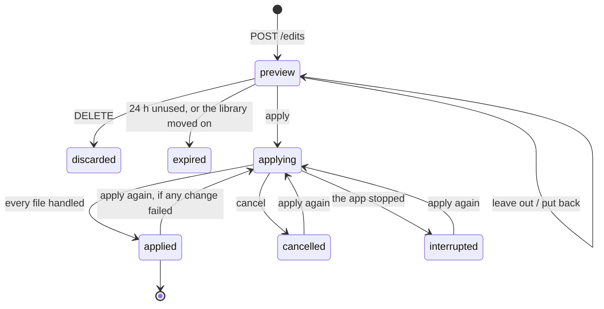
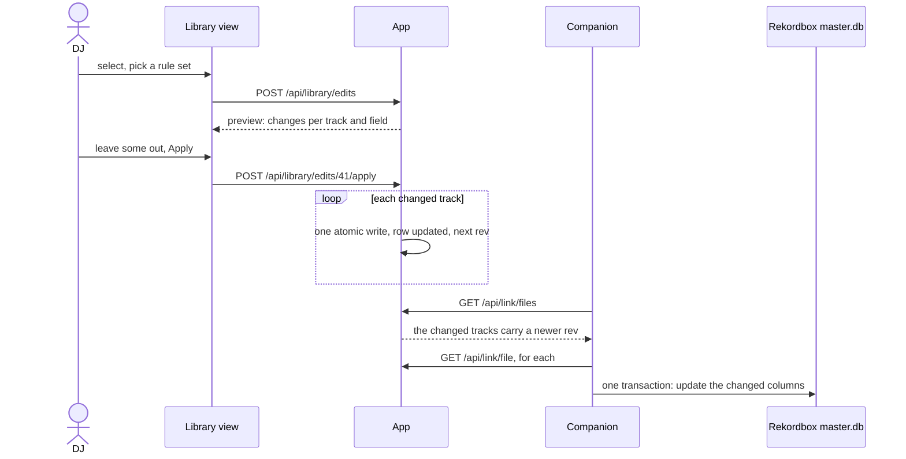

# Batch editing module

| | |
|---|---|
| **Status** | draft, waiting for the maintainer's approval |
| **Issues** | design [#20](https://github.com/Fre0Grella/getsetmix/issues/20), roadmap [#12](https://github.com/Fre0Grella/getsetmix/issues/12) |
| **Depends on** | the [Library module](library.md) ([#19](https://github.com/Fre0Grella/getsetmix/issues/19)), itself a draft |
| **Date** | 2026-11-13 |

System-level decisions are in the
[decision log](../architecture.md#9-decision-log) and are not repeated here.
This design rests on four of them: only tags change and files are never
renamed (decision 5), a track is identified by a hash of its audio
(decision 4), features run wherever the app runs (decision 3), and only
components that allow commercial use ship (decision 2). It adds no
dependency: the rules are plain Python, and tags are written with mutagen
through the Library module.

Choices in this document that the maintainer has not made are marked
**Proposal** and collected under [Open questions](#6-open-questions).
Where this module needs something the Library draft does not provide, it is
written as a requirement on that module in
[3.7](#37-what-this-module-needs-from-the-library-module), not redefined
here.

## 1. Goals and non-goals

### Goals

- **Edit many tracks at once.** Set, clear, extend or find-and-replace a tag
  on every selected track in the Library view.
- **Cleanup rules.** The fixes a DJ library needs again and again (letter
  case, "feat." handling, promotional text, stray separators, genre
  spellings) as rules that are picked from a menu, saved as a named set and
  reused.
- **Nothing is written blind.** Every batch is previewed per track and per
  field, and single tracks or single changes can be taken out before it is
  applied.
- **A batch can be undone**, whole or track by track.
- **The edits reach Rekordbox** on every paired computer, through the
  Library module's changed-file flow, with cues, grids and playlists kept.
- **The same in local mode**, with no server.

### Non-goals

- **Renaming or moving files.** Not from tags, not from a template.
- **Online tag lookup**, **duplicates by audio**, **genre detection** and any
  **audio analysis**. Out of the roadmap or in another stage (decision 6).
- **Tags from file names.** A file name is never parsed into tags here.
- **A scripting language** for tags. See the rule model in
  [4.1](#41-the-rule-model).
- **Running rules automatically on new downloads.** The rules are written so
  that this is possible later ([4.9](#49-rules-at-ingest-later)); it is not
  built in the first version.
- **Editing anything that lives only in Rekordbox**: ratings, colours, cues,
  playlists, BPM, key.

## 2. Where things stand

Checked against the code on 2026-11-13.

| Fact | Where |
|---|---|
| Tags can only be edited before a track is downloaded. `PATCH /api/tracks/{id}` is refused once the track is queued, and nothing edits a file that is already in the library. | `app/main.py`, `edit_track` |
| The tagger writes title, artist, album, genre, a comment and the cover. It never writes a year. It treats every file that is not `.flac` as MP3. | `app/tagger.py` |
| The comment it writes is `Source: <url> \| via GetSetMix`. It is the only place in the file that records where a track came from. | `app/tagger.py`, `comment_text` |
| At ingest, a fixed list of noise in brackets is stripped from titles ("Official Video", "Lyric Video", "Visualizer", "HD", "HQ", "4K", "Audio" and two Italian forms), and `Artist - Title` is split on five separators. | `app/metadata.py`, `clean_title`, `split_artist_title` |
| The genre list (42 names) and the one-tap picks live in the UI only. The server accepts any string as a genre. | `app/static/app.js`, `GENRES` |
| `/api/batch/start` and `/api/batch/cancel` already exist and mean the *download* batch. | `app/main.py` |
| The companion finds an artist, album or genre row in `master.db` by exact name among rows not marked deleted, and creates a new row when there is none. The comparison is case-sensitive. It never renames or removes such a row. | `companion/internal/library/import.go`, `ensureNamed` |
| On import the companion reads year and comment from the file into `ReleaseYear` and `Commnt`. | `companion/internal/audio/probe.go`, `import.go` |
| `djmdContent`, `djmdArtist` and `djmdAlbum` each have a `SearchStr` column that the importer leaves empty. | `companion/internal/library/librarytest/schema.sql` |

Because the word "batch" is taken by downloads, this module calls one run an
**edit**, and its API lives under `/api/library/edits`.

## 3. Interfaces and data contracts

### 3.1 Vocabulary

| Term | Meaning |
|---|---|
| **Selection** | the tracks an edit is aimed at |
| **Step** | one operation on one or more fields: a field operation or a rule |
| **Rule** | a named cleanup from the catalogue in [4.2](#42-the-rule-catalogue), with parameters |
| **Rule set** | a named, ordered, saved list of steps |
| **Edit** | a selection plus an ordered list of steps; it is previewed, then applied, and can be undone |
| **Change** | one field of one track going from an old value to a new one |

### 3.2 Fields

| Field | Type | Notes |
|---|---|---|
| `title`, `artist`, `album`, `genre` | text | the four fields the Library module edits |
| `year` | integer, 1900 to next year, or empty | **Proposal**: the year only; a full release date in the file is kept untouched unless the year is changed |
| `comment` | text | editable with field operations; **no rule touches it by default**, because it holds the source link |
| `cover` | image | set or clear for a whole selection; not a target of rules |

### 3.3 Selection

A selection is one of two things:

```json
{ "ids": [319, 320, 512] }
```

```json
{ "filter": { "q": "remix", "genre": "House", "folder": "2026" } }
```

- `ids` are Library file ids. `filter` takes the same `q`, `genre` and
  `folder` as `GET /api/library`, so "select all" on a filtered view is one
  request and not thousands of ids.
- **Proposal**: a filter is resolved into a list of ids **when the preview
  is made** and frozen there. Tracks that arrive later are not part of the
  edit, and what is applied is what was previewed.
- Only rows in state `present` take part. Rows that are not `editable`
  (read-only format, fallback id) are counted as *skipped*, with the reason.
- **Proposal**: at most 10,000 tracks per edit. A larger selection is
  refused with `413`, to be split by filter.

### 3.4 Steps

A step is a JSON object. There are two kinds.

**Field operations**

```json
{ "op": "set",     "field": "genre",  "value": "Tech House" }
{ "op": "clear",   "field": "album" }
{ "op": "append",  "field": "title",  "value": " (Live)" }
{ "op": "prepend", "field": "comment","value": "Checked. " }
{ "op": "replace", "field": "title",  "find": "Orig. Mix", "with": "Original Mix",
  "match": "text", "ignore_case": true }
{ "op": "set_cover", "source": "upload:7f3a" }
{ "op": "clear_cover" }
```

| `op` | Fields | Behaviour |
|---|---|---|
| `set` | all but cover | the field becomes `value`; for `year`, an integer |
| `clear` | album, genre, year, comment | the field becomes empty. Title and artist cannot be cleared. |
| `append`, `prepend` | text fields | `value` is added as given, spaces included; nothing is added to an empty field |
| `replace` | text fields | every occurrence of `find` becomes `with`. `match` is `text` (anywhere) or `word` (whole words only). `ignore_case` defaults to false. |
| `set_cover` | cover | the image from an upload made first with `POST /api/library/edits/covers`, or from `{"source": "url:https://…"}` |
| `clear_cover` | cover | the embedded cover is removed |

**Proposal**: `replace` matches plain text, not regular expressions. See
[4.1](#41-the-rule-model).

**Rules**

```json
{ "rule": "case.title", "fields": ["title", "album"], "params": { "keep": ["VIP", "UK"] } }
```

`rule` is an id from the catalogue. `fields` and `params` are optional;
each rule has defaults, listed in [4.2](#42-the-rule-catalogue).

Steps run in order. Each step sees the result of the one before it.

### 3.5 API

All under `/api/library`, behind the same auth as the rest of `/api`.

| Method and path | Purpose |
|---|---|
| `GET /api/library/rules` | the rule catalogue: ids, names in both languages, default fields, parameters, examples |
| `GET /api/library/rulesets` | saved rule sets |
| `POST /api/library/rulesets` | save a rule set |
| `PUT /api/library/rulesets/{id}` | rename, reorder or change it |
| `DELETE /api/library/rulesets/{id}` | remove it; built-in sets cannot be removed |
| `POST /api/library/edits` | make a preview from a selection and steps |
| `GET /api/library/edits` | history: past edits, newest first |
| `GET /api/library/edits/{id}` | state, counts and progress of one edit |
| `GET /api/library/edits/{id}/changes` | its changes, paged and filterable |
| `PATCH /api/library/edits/{id}` | leave tracks or single changes out, or put them back, before applying |
| `POST /api/library/edits/{id}/apply` | write it; also retries what failed |
| `POST /api/library/edits/{id}/cancel` | stop after the file in hand |
| `POST /api/library/edits/{id}/undo` | revert it, whole or for some tracks |
| `DELETE /api/library/edits/{id}` | discard a preview that was never applied |
| `POST /api/library/edits/covers` | upload an image for `set_cover`; returns its handle |

**Make a preview.** `POST /api/library/edits`

```json
{
  "selection": { "filter": { "genre": "House" } },
  "steps": [
    { "rule": "promo.remove" },
    { "rule": "mix.remove_default" },
    { "rule": "case.title" }
  ],
  "ruleset_id": 3
}
```

Either `steps` or `ruleset_id` is given; with both, `steps` wins and the set
only supplies the label. The answer is the edit in state `preview`:

```json
{
  "id": 41,
  "state": "preview",
  "label": "Standard cleanup",
  "catalogue": 1,
  "library_rev": 4812,
  "counts": {
    "selected": 512, "changed": 143, "unchanged": 361, "skipped": 8,
    "changes": 171,
    "by_field": { "title": 120, "artist": 31, "genre": 20 },
    "skipped_by_reason": { "read-only format": 6, "damaged file": 2 },
    "warnings": 4
  },
  "resend": { "tracks": 143, "bytes": 1432004608 }
}
```

`resend` says how many tracks, and how many bytes, every paired computer
will download again because of this edit
([4.6](#46-reaching-the-computers-and-rekordbox)).

**Read the changes.**
`GET /api/library/edits/41/changes?field=&state=&warning=&limit=200&cursor=`

```json
{
  "next": "eyJpIjo0MDB9",
  "items": [
    {
      "change_id": 9001,
      "file_id": 319,
      "path": "Nova - Night Drive.mp3",
      "field": "title",
      "old": "NIGHT DRIVE (Original Mix) [FREE DOWNLOAD]",
      "new": "Night Drive",
      "by": [
        { "step": 0, "rule": "promo.remove" },
        { "step": 1, "rule": "mix.remove_default" },
        { "step": 2, "rule": "case.title" }
      ],
      "warnings": [],
      "state": "pending"
    }
  ]
}
```

This is the dry-run contract: per track, per field, the old value, the new
value, and every step that had a hand in it. Changes of one track are
adjacent, so a client can group them.

| `state` of a change | Meaning |
|---|---|
| `pending` | will be written on apply |
| `excluded` | left out by the DJ |
| `blocked` | left out by the module; see the warning |
| `applied` | written |
| `failed` | the write failed; `error` says why; apply again to retry |
| `conflict` | the field no longer held `old` when its turn came; not written |
| `undone` | written, then reverted |

| Warning | Meaning | Effect |
|---|---|---|
| `would_empty` | the steps would leave the title or the artist empty | the change is `blocked` |
| `merges_values` | the file holds several values for this field (several artists as separate tags); writing makes them one | shown; still `pending` |
| `not_in_genre_list` | the genre has no match in the app's list | shown; the genre is left as it is |
| `too_long` | the new value is over 255 characters, the width of Rekordbox's columns | the change is `blocked` |

**Leave things out.** `PATCH /api/library/edits/41`

```json
{ "exclude": { "files": [320], "changes": [9001] }, "include": { "files": [], "changes": [] } }
```

Counts and `resend` are recomputed. Only an edit in state `preview` accepts
this.

**Apply.** `POST /api/library/edits/41/apply` answers `202` and the edit in
state `applying`. Progress is read from `GET /api/library/edits/41`:

```json
{
  "id": 41, "state": "applying",
  "progress": { "files_total": 142, "files_done": 57, "files_failed": 1, "files_conflict": 0 },
  "current": "Nova - Night Drive.mp3"
}
```

| Answer to apply | When |
|---|---|
| `202` | started |
| `409` | another edit is applying, or this one is not in a state that can be applied |
| `410` | the preview expired ([4.7](#47-the-journal-and-undo)) |

**Undo.** `POST /api/library/edits/41/undo` with an empty body reverts the
whole edit; with `{ "files": [319, 512] }` only those tracks. It answers
`202` with a **new** edit whose `undo_of` is 41, already applying. An undo is
an edit like any other: it has changes, progress, failures, and it appears
in the history.

**Rule sets.**

```json
{
  "id": 3,
  "name": "Standard cleanup",
  "builtin": true,
  "steps": [ { "rule": "promo.remove" }, { "rule": "url.remove" } ],
  "updated_at": "2026-11-13T10:00:00+00:00"
}
```

A rule set is plain JSON, so it can be copied between two GetSetMix
installs by hand.

### 3.6 Tables

Three tables in `getsetmix.db`, next to the Library module's.

```sql
CREATE TABLE rule_sets (
    id         INTEGER PRIMARY KEY,
    name       TEXT    NOT NULL UNIQUE,
    steps      TEXT    NOT NULL,          -- JSON array of steps, in order
    builtin    INTEGER NOT NULL DEFAULT 0,
    created_at TEXT    NOT NULL,
    updated_at TEXT    NOT NULL
);

CREATE TABLE edits (
    id          INTEGER PRIMARY KEY,
    state       TEXT    NOT NULL,
                -- preview | applying | applied | cancelled | interrupted
                -- | discarded | expired
    label       TEXT    NOT NULL DEFAULT '',   -- rule set name, or a summary of the steps
    selection   TEXT    NOT NULL,              -- JSON, as sent
    steps       TEXT    NOT NULL,              -- JSON, as run
    catalogue   INTEGER NOT NULL,              -- catalogue version the preview was made with
    library_rev INTEGER NOT NULL,              -- the library's rev at preview time
    undo_of     INTEGER REFERENCES edits (id), -- set on an undo
    created_at  TEXT    NOT NULL,
    applied_at  TEXT,
    finished_at TEXT
);

CREATE TABLE edit_changes (
    id        INTEGER PRIMARY KEY,
    edit_id   INTEGER NOT NULL REFERENCES edits (id) ON DELETE CASCADE,
    file_id   INTEGER NOT NULL,           -- library_files.id
    audio_id  TEXT    NOT NULL,           -- survives a row being re-created
    field     TEXT    NOT NULL,           -- title | artist | album | genre | year | comment | cover
    old_value TEXT,                       -- for cover: a handle into the cover store, or NULL
    new_value TEXT,
    by        TEXT    NOT NULL,           -- JSON: the steps that produced it
    warnings  TEXT    NOT NULL DEFAULT '[]',
    state     TEXT    NOT NULL,           -- pending | excluded | blocked | applied | failed | conflict | undone
    error     TEXT    NOT NULL DEFAULT ''
);
CREATE INDEX edit_changes_edit ON edit_changes (edit_id, file_id);
```

- Counts are computed from `edit_changes`, not stored.
- Tracks that an edit selects but does not change get no rows. The edit
  keeps their number in the preview answer only.
- Covers replaced or removed by an edit are kept as files under
  `<data>/edits/<edit id>/<file id>.img`, so a cover change can be undone.

**Settings.** One new setting, `edit_history_days` (`GSM_EDIT_HISTORY_DAYS`,
**Proposal**: default 90; 0 keeps the history for good).

### 3.7 What this module needs from the Library module

The Library draft does not yet provide these. Each is a requirement on that
module, to be settled in its design, not a second definition here.

| # | Requirement | Why |
|---|---|---|
| L1 | **One write for several fields.** An internal function that writes any set of fields to one file in one atomic copy-tag-rename, updates the row and takes one `rev`. `PATCH /api/library/{id}` already accepts several fields; the function must be callable without HTTP. | A batch must not copy a 10 MB file once per field. |
| L2 | **A precondition on that write.** The function takes the values the caller expects the fields to hold and refuses, without writing, when one differs. | So an edit only overwrites what its preview showed. |
| L3 | **`year` and `comment` are editable.** The Library draft's edit takes title, artist, album and genre. The tagger's edit path has to write the year (`TDRC` in ID3v2.4, `date` in FLAC) and the comment. | Both are fields of this module. |
| L4 | **Year and comment reach Rekordbox.** The companion's update of a changed track covers `ReleaseYear` and `Commnt` as well as the four columns in the Library draft's 4.6, and `fetched.json` remembers them next to the other tags. | Otherwise a year set on the server never shows in Rekordbox. |
| L5 | **The cover write returns what it replaced.** The internal cover function hands back the previous image, or says there was none. | Undo of a cover change. |
| L6 | **A filter resolves to ids on the server.** The query behind `GET /api/library` is callable internally and returns ids with their `editable` flag. | Selection by filter. |
| L7 | **Values are indexed as they are in the file.** No trimming or folding in `title`, `artist`, `album`, `genre`, `comment`; folding belongs in `search` only. | The preview's "old value" has to be the file's value, or a trim rule would see nothing to do. |
| L8 | **One rule for several values.** How the index shows a field that holds several values in the file (separate `ARTIST` comments in FLAC, a multi-value `TPE1`), and that it can tell this module so. | The `merges_values` warning. |
| L9 | **Bulk "set genre" goes through here.** Once this module exists, `POST /api/library/bulk` with `set_genre` creates an edit, so it is previewed, journalled and undoable like every other bulk change. Bulk delete and restore stay where they are. | One way to change many tags, not two. |

One more, outside the Library module: the **genre list moves to the
server** (`app/genres.py`, served to the UI through `/api/library/rules` or
the settings), because the `genre.map` rule runs there.

## 4. Design

### 4.1 The rule model

**Proposal: a fixed menu of parameterised rules, plus plain find and
replace. No rule language.**

- The catalogue in 4.2 is the menu. Each rule is one Python function with a
  few parameters, a default set of fields, and a table of examples that is
  also its test.
- A **rule set** is an ordered list of rules with their parameters. That is
  all the "programming" there is: which rules, in which order, with which
  word lists.
- **Find and replace** covers the long tail the menu does not: one text, one
  replacement, whole word or not, case or not.

Why not a rule language (the alternative, as Mp3tag's actions and format
strings do it):

| | Fixed menu | Rule language |
|---|---|---|
| Use on a phone, one thumb | toggles and a few lists | typing expressions and escapes |
| What can go wrong | a rule does too much; the preview shows it | a typo empties a field on 500 tracks; errors need their own messages |
| Testing | every rule has a table of cases | every expression is new, untested code |
| Cost to build | a dozen functions | a parser, an evaluator, documentation, a help view |
| Reach | the fixes listed in 4.2 | anything |

The fixes a DJ library needs are few and known. The menu covers them, and a
rule that is missing can be added to the catalogue in one small change. A
language would be paid for in full on the first day and used for the same
dozen fixes.

**Proposal: no regular expressions in the first version**, not even in
find and replace. They are the rule language by another door, they are
unusable on a phone, and a pattern that backtracks badly can pin the server.
If the menu proves too narrow, a regex option on `replace` is the smallest
possible addition, and the step format has room for it (`"match": "regex"`).

**How a rule works**

- A rule is a pure function: the track's fields and the parameters go in,
  the fields come out. It reads no file and no database.
- Rules live in `app/rules.py`. Preview and apply run on the server only, so
  there is one implementation and no copy in JavaScript.
- Most rules work on one field at a time. Three work across fields
  (`feat.move`, `split.artist_title`, `year.extract`) and say so.
- After every step a **tidy** pass runs on the fields that step touched:
  runs of spaces become one, spaces at the ends go, empty brackets `()` `[]`
  go, and a separator left dangling at an end (` - `, `,`) goes. It is the
  same clean-up `render_filename` does for file names.
- **Every rule is idempotent**: running it on its own output changes
  nothing. The tests check it for every case.
- A rule never invents text. It removes, moves or respells what is there.

**Versioning.** The catalogue has a version number, returned with it and
stored on every edit. Rule ids are stable. When a rule's behaviour changes,
the version goes up. This matters little, because **undo never runs a rule
again**: it writes back the old values the journal holds.

### 4.2 The rule catalogue

Names in the examples are made up. "Default fields" are the fields a rule
works on when the step names none.

| Rule id | What it does | Default fields | Parameters (defaults) |
|---|---|---|---|
| `trim` | spaces, odd whitespace, control characters | title, artist, album, genre | `underscores` (false) |
| `promo.remove` | promotional and video text in brackets | title | `phrases` (list below) |
| `url.remove` | web addresses and handles | title, artist, album | none |
| `split.artist_title` | "Artist - Title" left in the title | title, artist | `when` (`artist_empty_or_same`) |
| `feat.normalise` | one spelling for "featuring" | title, artist | `spelling` (`feat.`) |
| `feat.move` | featured artist to the title, or to the artist | title, artist | `to` (`title`) |
| `mix.remove_default` | "(Original Mix)" and its kin | title | `labels` (list below) |
| `mix.brackets` | one bracket style for mix and remix names | title | `mix_words` (list below) |
| `artist.separators` | one separator between artists | artist | `from` (list below), `to` (`, `), `keep` (empty) |
| `case.title` | fixes ALL CAPS and all lower case | title, album | `only_uniform` (true), `small_words`, `keep` |
| `genre.map` | genre spellings onto the app's list | genre | `aliases` (table below) |
| `year.extract` | a year out of the title or album | year, title, album | `remove` (false) |

#### `trim`

| Before | After |
|---|---|
| `"  Night   Drive "` | `"Night Drive"` |
| `"Night Drive"` (no-break space) | `"Night Drive"` |
| `"Night_Drive"`, with `underscores: true` | `"Night Drive"` |
| `"Night_Drive"`, default | unchanged |

#### `promo.remove`

Removes a bracketed segment, round or square, whose whole content is one of
`phrases`, compared without case. The default list is a superset of what
ingest already strips: Free Download, Free DL, Out Now, Official Video,
Official Audio, Official Music Video, Official Visualizer, Visualizer, Lyric
Video, Lyrics, Audio, Video, HD, HQ, 4K, Premiere, Preview, Clip, Full
Track, Video Ufficiale, Testo.

| Before | After |
|---|---|
| `"Night Drive (Extended Mix) [FREE DOWNLOAD]"` | `"Night Drive (Extended Mix)"` |
| `"Night Drive (Official Video)"` | `"Night Drive"` |
| `"Night Drive [HQ] (Kito Remix)"` | `"Night Drive (Kito Remix)"` |
| `"Night Drive (Free)"` | unchanged: "Free" alone is not in the list |
| `"Free Download"` (no brackets) | unchanged: only bracketed text is removed |

#### `url.remove`

Removes `http://…`, `https://…`, `www.…`, a bare `name.tld` for a short
list of endings (com, net, org, io, fm, dj, co, it, de, uk), and `@handle`
at the end of a value. It never runs on the comment unless the step names
that field.

| Before | After |
|---|---|
| `"Night Drive - www.example.com"` | `"Night Drive"` |
| `"Night Drive [example.com]"` | `"Night Drive"` |
| `"Nova @novamusic"` | `"Nova"` |
| `"Mr. Fingers"` | unchanged |

#### `split.artist_title`

Works on title and artist together. It splits on the separators ingest
already uses: ` - `, ` – `, ` — `, ` | `, ` － `.

| `when` | Splits when |
|---|---|
| `artist_empty_or_same` (default) | the artist is empty, or the title starts with the artist followed by a separator |
| `artist_empty` | the artist is empty |
| `always` | the title holds a separator; the left part replaces the artist |

| Before | After |
|---|---|
| title `"Nova - Night Drive"`, artist `""` | title `"Night Drive"`, artist `"Nova"` |
| title `"Nova - Night Drive"`, artist `"Nova"` | title `"Night Drive"`, artist `"Nova"` |
| title `"Nova - Night Drive"`, artist `"Kito"` | unchanged with the default; with `always`: artist `"Nova"` |
| title `"Night Drive - Kito Remix"`, artist `"Nova"` | unchanged: the left part is not the artist. `mix.brackets` handles this. |

#### `feat.normalise`

Respells `ft`, `ft.`, `feat`, `feat.`, `featuring`, in any case, as whole
words only, to `spelling`. Square brackets around a featuring become round.

| Before | After |
|---|---|
| `"Night Drive (Ft. Kito)"` | `"Night Drive (feat. Kito)"` |
| `"Night Drive [Featuring Kito]"` | `"Night Drive (feat. Kito)"` |
| `"Nova FEAT Kito"` | `"Nova feat. Kito"` |
| `"Left Behind"`, `"Soft Focus"` | unchanged: "ft" inside a word is not a match |

#### `feat.move`

Works on title and artist together. Run it after `feat.normalise`.

| `to` | Before | After |
|---|---|---|
| `title` (default) | artist `"Nova feat. Kito"`, title `"Night Drive"` | artist `"Nova"`, title `"Night Drive (feat. Kito)"` |
| `title` | artist `"Nova feat. Kito"`, title `"Night Drive (Extended Mix)"` | artist `"Nova"`, title `"Night Drive (feat. Kito) (Extended Mix)"` |
| `title` | artist `"Nova"`, title `"Night Drive (feat. Kito)"` | unchanged |
| `artist` | artist `"Nova"`, title `"Night Drive (feat. Kito)"` | artist `"Nova feat. Kito"`, title `"Night Drive"` |
| `artist` | artist `"Nova feat. Kito"`, title `"Night Drive (feat. Kito)"` | artist `"Nova feat. Kito"`, title `"Night Drive"` |

The featured artist goes before a mix name in the title, never after it.

**Proposal**: the default is `title`. On a player, browsing by artist then
shows one entry per artist and not one per collaboration.

#### `mix.remove_default`

Removes a bracketed segment whose content is one of `labels`, without case.
Default: Original Mix, Original, Original Version. Names that tell two files
apart (Extended Mix, Radio Edit, Club Mix, Dub) are never in the default.

| Before | After |
|---|---|
| `"Night Drive (Original Mix)"` | `"Night Drive"` |
| `"Night Drive [Original]"` | `"Night Drive"` |
| `"Night Drive (Extended Mix)"` | unchanged |
| `"Original Mix"` (the whole title) | unchanged; it would empty the title |

#### `mix.brackets`

Gives a mix or remix name round brackets when it is in square brackets or
hangs off the title after a separator. A tail counts as a mix name when its
last word is one of `mix_words`: Mix, Remix, Edit, Rework, Bootleg, Dub,
Version, VIP, Flip, Mashup, Refix, Remaster.

| Before | After |
|---|---|
| `"Night Drive [Kito Remix]"` | `"Night Drive (Kito Remix)"` |
| `"Night Drive - Kito Remix"` | `"Night Drive (Kito Remix)"` |
| `"Night Drive - Extended Mix"` | `"Night Drive (Extended Mix)"` |
| `"Night Drive - Part Two"` | unchanged: "Two" is not a mix word |
| `"Night Drive (Kito Remix)"` | unchanged |

#### `artist.separators`

Replaces the separators in `from` with `to`. Default `from`: ` x `, ` X `,
` vs `, ` vs. `, ` Vs. `, `;`, ` / `, ` + `. A value listed in `keep` is
never touched.

| Before | After |
|---|---|
| `"Nova x Kito"` | `"Nova, Kito"` |
| `"Nova vs. Kito"` | `"Nova, Kito"` |
| `"Nova;Kito"` | `"Nova, Kito"` |
| `"Sun & Moon"` | unchanged: `&` is not in the default |
| `"Nova & Kito"`, with ` & ` added to `from` | `"Nova, Kito"` |
| `"Sun & Moon"`, same step, `keep: ["Sun & Moon"]` | unchanged |

**Proposal**: ` & ` and ` and ` are not separators by default. Many acts
carry them in their name, and a rule cannot tell an act from a pair.

#### `case.title`

Capitalises each word, except `small_words` (a, an, and, as, at, but, by,
for, in, of, on, or, the, to, vs, with, feat.) inside a value. The first
word, the last word and the first word inside brackets are always
capitalised. A word in `keep` is written exactly as listed; the default
holds DJ, MC, UK, US, USA, NYC, LA, EP, LP, VIP, ID, II, III, IV, EDM, BPM,
R&B, and the DJ adds artist spellings to it.

| `only_uniform` | Meaning |
|---|---|
| true (default) | only a value that is entirely upper case or entirely lower case is changed |
| false | every value is re-cased |

| Before | After |
|---|---|
| `"NIGHT DRIVE"` | `"Night Drive"` |
| `"night drive (extended mix)"` | `"Night Drive (Extended Mix)"` |
| `"LOST IN THE CITY"` | `"Lost in the City"` |
| `"NIGHT DRIVE (VIP MIX)"` | `"Night Drive (VIP Mix)"` |
| `"Night Drive"` | unchanged |
| `"night Drive pt. II"` | unchanged with the default: the value is mixed case |

**Proposal**: the artist is not a default field. An artist written in
capitals is usually written that way on purpose. The rule can be aimed at
the artist by naming the field in the step.

#### `genre.map`

Maps a genre onto the app's genre list. Two values match when they are
equal after lower-casing and dropping spaces, hyphens, `&`, `and` and
punctuation. `aliases` adds spellings that this cannot reach; the default
table holds the common ones.

| Before | After |
|---|---|
| `"tech-house"`, `"TechHouse"`, `"TECH HOUSE"` | `"Tech House"` |
| `"Drum and Bass"`, `"Drum n Bass"`, `"DnB"`, `"D&B"` | `"Drum & Bass"` |
| `"Hip Hop"`, `"hiphop"` | `"Hip-Hop"` |
| `"RnB"` | `"R&B"` |
| `"Melodic Techno"` | `"Melodic House & Techno"` (alias) |
| `"Dark Disco"` | unchanged, with the warning `not_in_genre_list` |

A genre the list does not know is left alone. The preview lists such genres
with their counts, so the DJ can add an alias and run the rule again.

#### `year.extract`

Works on year, title and album together, and only when the year is empty.
It takes a four-digit year between 1900 and next year that stands **alone**
in round or square brackets at the end of the title, then of the album.

| Before | After |
|---|---|
| title `"Night Drive [2019]"`, year empty | year `2019`; title unchanged |
| the same, with `remove: true` | year `2019`, title `"Night Drive"` |
| title `"Night Drive (2019 Remaster)"` | unchanged: the year does not stand alone |
| title `"Night Drive [2019]"`, year `2021` | unchanged: the year is set |
| title `"1999"` | unchanged: not in brackets |

A year that only sits in the file's full date needs no rule: the index
already reads it.

#### The built-in rule set

**Proposal**: one rule set ships with the app, **Standard cleanup**, as a
starting point. It can be copied and changed, not removed. Its order:

1. `promo.remove`
2. `url.remove`
3. `trim`
4. `split.artist_title`
5. `feat.normalise`
6. `feat.move` (`to: title`)
7. `mix.remove_default`
8. `mix.brackets`
9. `artist.separators`
10. `case.title`
11. `genre.map`

The order matters: junk goes first so the rules after it see clean text,
structure is settled before case, and case runs last on the title so it
also fixes what the other rules moved. `year.extract` is not in the set; it
is run on purpose.

### 4.3 Preview



Making a preview:

1. Resolve the selection to ids and freeze it.
2. For each track, read its fields from the index, run the steps in order,
   and compare the result with what went in.
3. For each field that differs, store one change with the old value, the new
   value and the steps that touched it. Apply the warnings.
4. Answer with the counts.

Nothing is read from the audio files and nothing is written to them. On
3,000 tracks this is string work on rows already in SQLite, well under a
second.

**The preview is stored, and apply writes what it stored.** Apply does not
run the rules again. This is the heart of "nothing is written blind": the
DJ confirms a list of changes, and that exact list is what happens.

**Proposal**: a preview that is not applied expires after 24 hours. It also
cannot be applied when it is older than another edit applied since: the
answer is `410`, and the UI makes a fresh preview with the same steps.

**On a desktop**

- The Library view's selection bar gains **Edit tags**. It opens a panel
  beside the list with two tabs: **Fields** (one row per field: leave, set,
  clear, add before, add after, replace) and **Cleanup** (the rule sets, and
  for the chosen one its rules as a list that can be reordered, switched off
  and given parameters).
- **Preview** fills a table grouped by track. Each change is a row: field,
  before, after, with the differing part highlighted. Each row and each
  track has a checkbox.
- Above the table: the counts, the skipped tracks with their reasons, the
  warnings as filters ("show only changes with a warning"), a filter per
  field, and what the computers will download again.
- **Apply** names the numbers: *Change 171 tags on 143 tracks*.

**On a phone**

- The selection bar offers **Edit tags** as a sheet in three steps.
- **1. What.** A rule set to pick with one tap, or one field operation.
  Building or reordering a rule set is possible but meant for the desktop.
- **2. Check.** One card per track: title and artist, then each change as
  *before* over *after*. A switch on the card leaves the track out; a tap on
  a change leaves that change out. Tracks with warnings come first.
- **3. Apply.** A progress bar, the counts, and at the end the failures with
  *Retry*.

Both: English and Italian, light and dark, like the rest of the UI. Rule
names and descriptions come from the catalogue, in both languages.

### 4.4 Apply

Apply runs as a job in the app, one file at a time.

For each track with pending changes:

1. Collect all its pending changes into one write.
2. Call the Library module's write
   ([L1](#37-what-this-module-needs-from-the-library-module)) with the new
   values and, as the precondition
   ([L2](#37-what-this-module-needs-from-the-library-module)), the old values
   from the preview.
3. On success, mark its changes `applied`. The Library module has updated
   the row and taken the next `rev`.
4. If the precondition fails, mark them `conflict` and write nothing to that
   file: something else changed it since the preview.
5. On any other failure, mark them `failed` with the reason and go on.

| Property | How |
|---|---|
| **Atomic per file** | The Library module's edit path copies the file under a hidden name, tags the copy and renames it over the original. A file holds either all of its changes or none. |
| **One copy per file** | All fields of a track go in one write, whatever the number of steps. |
| **One failure never stops the edit** | Each file is its own unit. The edit ends `applied` with a count of failures, and *apply again* retries only those. |
| **Not atomic across files** | An edit that is cancelled, or cut short by a restart, leaves some tracks changed and some not. The journal knows which. It can be continued, or undone. |
| **Order** | The order of the Library list at preview time, so progress on screen runs top to bottom. |
| **Cancel** | Takes effect after the file in hand. What was written stays and can be undone. |
| **A restart** | On startup an edit found `applying` becomes `interrupted`. Its `pending` changes are still pending; the file in hand at the time is whole, old or new. |
| **Disk space** | The copy needs free space the size of the file. A full disk fails that file, not the edit. |

**Failures a file can have**

| Reason | Cause | What the DJ does |
|---|---|---|
| `in use` (`423`) | local mode on Windows: a deck has the file loaded | unload it, apply again |
| `gone` (`410`) | trashed or missing since the preview | nothing |
| `read-only` (`409`) | cannot happen for a previewed change, unless the file was replaced by another format | nothing |
| `no space` | the disk is full | free space, apply again |
| `write error` | anything else from the tagger or the file system | read the detail; apply again |

**One edit applies at a time** (**Proposal**). A second apply is refused
with `409` until the first is done. Previews can be made meanwhile.

**Together with downloads.** A download only ever creates a new file, and
an edit only touches files that exist, so the two never write the same
file. Both go through the Library module to change the index, which
serialises them. Edits are not slowed for downloads or the other way round;
both are bound by the disk.

**Together with the reconcile pass.** The edit path updates the row's size
and time itself, so the next pass sees nothing to do. The hidden copies are
skipped by the walk.

**Cost.** One file copy per changed track: about 10 MB each, so 500 tracks
is 5 GB written. On a home server's disk that is a minute or two. The
progress view exists because this is not instant.

### 4.5 What may be edited

Per format, in the first version. It follows the Library module's
[table](library.md#34-tag-fields-per-format): MP3 and FLAC are editable,
the rest is read-only until that module opens them.

| Field | MP3 (ID3v2.4) | FLAC (Vorbis comment) | M4A, AIFF, WAV, AAC, Ogg, Opus |
|---|---|---|---|
| Title | `TIT2` | `title` | read-only |
| Artist | `TPE1` | `artist` | read-only |
| Album | `TALB` | `album` | read-only |
| Genre | `TCON` | `genre` | read-only |
| Year | `TDRC` | `date` | read-only |
| Comment | `COMM` (language `eng`, empty description) | `comment` | read-only |
| Cover | `APIC` (type 3, front cover) | `PICTURE` block (type 3) | read-only |

- **Year.** When a file holds a full date and the year is not changed, the
  date is not touched. When the year is changed, the tag is written as the
  year alone (**Proposal**).
- **Several values.** Where a file holds several values for a field, an
  edit of that field writes one value, and the preview warns
  (`merges_values`). A field that is not edited keeps its several values.
- **Other tags** (BPM, key, label, remixer, track number, anything a DJ app
  wrote) are never read into an edit and never changed by one.

**What stays read-only**

- Files in a read-only format, and files with a fallback id.
- Tracks in the trash or missing.
- File names and folders.
- Everything Rekordbox owns: ratings, colours, My Tags, cues, grids,
  playlists.

### 4.6 Reaching the computers and Rekordbox

Nothing new travels. An applied change is a tag edit in the Library
module's sense, so its
[changed-file flow](library.md#46-what-a-computer-does) carries it: the
listing shows a newer `rev` for the track, the companion downloads the file
again, the importer sees a handled file that changed and updates the row in
`master.db` under the importer's safety. Cues, grid, analysis and playlist
entries hang off the row's id and stay.



Three things are specific to doing this in bulk.

**The download cost.** A computer learns of a tag change by downloading the
file again. One edited track is 10 MB. An edit over 500 tracks is 5 GB to
every paired computer. The companion fetches for 20 seconds before
Rekordbox starts and every 15 minutes otherwise, so a large edit arrives
over several runs; each track is consistent on its own, so a half-arrived
edit is harmless. The preview says how many tracks and bytes will travel
(`resend`), so the DJ decides with the number in front of them.
**Proposal**: accept this in the first version. The Library draft rejects
sending tags without the file, for good reasons; if large edits prove
painful in use, that decision is the one to revisit, in that module.

**One write to `master.db` per sync.** The importer handles every changed
file it finds in one transaction, so 500 changed tracks are one backup, one
transaction and one integrity check, not 500.

**Artist, album and genre rows.** In `master.db` these are rows of their
own, and a track points at them. The companion finds the row by exact,
case-sensitive name and creates it when missing. So a bulk change has side
effects a single edit hides:

| The edit | In `master.db` |
|---|---|
| 200 tracks go from genre "tech-house" to "Tech House", which exists | the tracks point at the existing "Tech House" row. The "tech-house" row stays, with no tracks. |
| 40 tracks go from artist "NOVA" to "Nova", which does not exist | a "Nova" row is created; the "NOVA" row stays, with no tracks. |
| `feat.move` turns "Nova feat. Kito" into "Nova" | the tracks join the "Nova" row; "Nova feat. Kito" stays, with no tracks. |
| The edit is undone | the tracks point at the old rows again; the rows the edit created stay, with no tracks. |

The companion **reuses, creates and never deletes or renames** these rows.
A row may also be used by tracks GetSetMix never handled, and Rekordbox may
give it meaning of its own. What Rekordbox shows for a row with no tracks is
not known; it is on the manual checklist and in the open questions.

Year and comment reach `ReleaseYear` and `Commnt` once the Library module
covers them
([L4](#37-what-this-module-needs-from-the-library-module)).

When the DJ changed a field in Rekordbox and the server changed the same
field, the Library module's rule decides (its proposal: the server wins). A
batch makes that rule matter more, since it touches many tracks at once;
nothing here changes it.

### 4.7 The journal and undo

The journal is the `edits` and `edit_changes` tables. Every applied change
is in it with its old and new value. Covers that were replaced are in the
cover store.

**Undo is a new edit** that writes the old values back. It uses the same
apply job, the same atomic write and the same precondition, with the roles
swapped: the field must still hold the value the edit wrote.

| Case | What undo does |
|---|---|
| The field still holds what the edit wrote | writes the old value back; the original change becomes `undone` |
| The field was changed again since, by hand or by a later edit | leaves it alone and reports it as `conflict` (**Proposal**). Undo never overwrites newer work. |
| The track is in the trash | reports it as `gone`. Restore the track, then undo again. |
| The track was deleted for good | nothing to undo |
| Only some tracks are asked for | only their changes are reverted; the edit shows as partly undone |
| The edit never finished (cancelled, interrupted) | what was applied is reverted; what was pending is dropped |

Undoing an undo is allowed: it is an edit like any other.

**After the change has reached Rekordbox.** Undo on the server is one more
tag change. It travels to each computer the same way and at the same cost:
the file is downloaded again, and the importer writes the old values back
into the row.

- A computer that never fetched the first change sees only the final state:
  the listing's `rev` is newer than the one it holds, the tags it reads
  equal the tags it remembers, and it writes nothing to `master.db`.
- A computer that did fetch it gets the old values back. Artist, album or
  genre rows the edit created stay behind, empty.
- If the DJ changed the same field in Rekordbox in between, the Library
  module's conflict rule decides, as for any server change.
- Undo cannot reach a USB stick that was exported in between. The next
  export carries the reverted tags.

**Retention** (**Proposal**).

| What | Kept |
|---|---|
| A preview that was never applied | 24 hours |
| An applied edit: its changes, and the covers it replaced | `edit_history_days`, default 90; 0 keeps them for good |
| The edit's line in the history (label, date, counts) | for good; without its changes it can no longer be undone, and says so |

A purge runs once a day, with the Library module's trash purge.

### 4.8 Local mode

With no server the app runs on the DJ's computer over the folder the
companion watches. The same API and the same view work there.

| | With a server | Local mode |
|---|---|---|
| Where the file is written | on the server | in place, in the folder Rekordbox reads |
| How Rekordbox learns | fetch, then the importer | the importer's next sync, right before Rekordbox starts |
| Download cost | each track again, to each computer | none |
| A file loaded on a deck | not affected until the next fetch | the write fails with `in use`; unload it and apply again |
| Rekordbox open during a big edit | no effect on the server | files not loaded are written; the rows are updated the next time Rekordbox is started through the launcher |

In local mode a large edit is best applied with Rekordbox closed. The view
says so when the companion reports that Rekordbox is running, if that
report is available; it does not refuse.

### 4.9 Rules at ingest, later

Not built in the first version. The rules are pure functions, so the
staging step can call them later: a setting names a rule set, and it runs on
a track's fields when its metadata arrives. The DJ still sees and fixes
every field before the download, as today.

| Fit for ingest | Not fit |
|---|---|
| `trim`, `promo.remove`, `url.remove`, `split.artist_title`, `feat.normalise`, `mix.remove_default`, `mix.brackets`, `genre.map` | `case.title` (a wrong guess is silent on a phone), `feat.move` and `artist.separators` (a matter of taste to be set once, on purpose), `year.extract` |

When that is built, `metadata.clean_title` and `split_artist_title` become
calls to `promo.remove` and `split.artist_title`, so ingest and cleanup
cannot disagree.

## 5. Testing

| Layer | What is tested |
|---|---|
| **The rule table** | `tests/rules_cases.json`: one list of cases for the whole catalogue. Each case names a rule, its parameters, the fields going in and the fields expected out. Every before/after pair in [4.2](#42-the-rule-catalogue) is a case in it, and a test fails when the document's examples and the file drift apart. `tests/test_rules.py` runs every case. |
| **Rule properties** | For every case: running the rule on its own output changes nothing. No rule returns an empty title or artist. No rule changes a field it was not given. Unicode: accents, non-Latin scripts, emoji and right-to-left text pass through whole. |
| **Steps and order** | The built-in rule set on a table of messy inputs; the same rules in another order, to pin the cases where order matters. Field operations, including `append` on an empty field and `replace` with `word` and `ignore_case`. |
| **Preview** (pytest, as `tests/test_api.py`) | Selection by ids and by filter; the filter is frozen; skipped tracks and their reasons; each warning; leaving out and putting back; paging; expiry. Nothing on disk changes during a preview. |
| **Apply** | A real MP3 and a real FLAC per case: the tags in the file equal the previewed new values; tags the edit did not touch are byte-for-byte the same; the audio id is unchanged; the row and `rev` moved once per file. |
| **Failure injection** | A file made read-only, a file removed, a file changed between preview and apply (`conflict`), a full disk simulated at the copy, a tagger that raises on the n-th file. In each: that file fails, the rest are applied, the counts are right, and *apply again* retries only the failures. |
| **Cancel and restart** | Cancel in the middle; kill the job in the middle and start again: no half-written file, the journal matches the disk, the edit can be continued or undone. |
| **Undo** | Whole and partial; a field changed since; a trashed track; undo of an undo; a cover restored from the store. After a full undo every file's tags equal what they were, compared field by field. |
| **Retention** | Expired previews and old journals are purged; the history line stays. |
| **Companion** (Go, with the `librarytest` fixture) | A batch of changed tracks is written in one transaction; an artist, album or genre row is reused by exact name and created when missing; no such row is ever deleted; year and comment reach their columns; cues and playlist rows are untouched. |
| **UI** | Preview table and cards with a few hundred changes on a phone-sized viewport; excluding a change and a track; both languages. |

**Manual checklist against a real Rekordbox**, on a copy of a library:

- [ ] Apply the built-in rule set to about 50 tracks on the server. After
      fetch and launch, each row shows the new title, artist and genre.
- [ ] Those tracks keep their hot cues, memory cues, beat grid, rating and
      place in every playlist.
- [ ] Rekordbox's search finds an edited track under its new title and
      artist (the `SearchStr` columns are not written by the companion).
- [ ] An artist row and a genre row that an edit left with no tracks: what
      Rekordbox shows in the Artist and Genre columns of the browser, and
      whether it removes them itself.
- [ ] Undo the edit on the server. After the next fetch and launch, the rows
      show the old values again.
- [ ] Set a year on tracks that had none; `ReleaseYear` shows it.
- [ ] A USB export of edited tracks carries the new tags, and a player
      lists them under the new artist and genre.
- [ ] In local mode on Windows, apply an edit with one of the tracks loaded
      on a deck: that track fails with a clear message, the others are
      written.

## 6. Open questions

Each is a choice made in this draft that the maintainer can overrule.

| # | Question | Proposed here |
|---|---|---|
| 1 | The rule model | a fixed menu of parameterised rules, saved as ordered rule sets, plus plain find and replace; no rule language |
| 2 | Regular expressions in find and replace | not in the first version |
| 3 | Where a featured artist goes by default | into the title, `(feat. X)`, before the mix name |
| 4 | What the case rule touches | only values entirely in upper or lower case; title and album, not the artist |
| 5 | `&` and "and" as artist separators | not by default; opt-in, with a keep list |
| 6 | A built-in rule set | *Standard cleanup*, eleven rules in the order of [4.2](#42-the-rule-catalogue), copyable, not removable |
| 7 | Selection by filter | frozen into ids when the preview is made; at most 10,000 tracks per edit |
| 8 | Preview | stored on the server; apply writes exactly the stored changes and skips a field that no longer holds the previewed old value; an unused preview expires after 24 hours |
| 9 | Edits at the same time | one applies at a time; previews are free |
| 10 | How long an edit can be undone | `edit_history_days`, default 90, covers included |
| 11 | Undo against newer changes | undo skips a field changed since and reports it |
| 12 | The comment | editable with field operations; no rule touches it unless told to, because it holds the source link |
| 13 | Year or full release date | the year only; a full date in the file is kept unless the year is changed |
| 14 | A field with several values in the file | editing it writes one value, with a warning in the preview |
| 15 | A change that would empty the title or the artist | blocked |
| 16 | The download cost of a large edit | accepted in the first version and shown in the preview; no tags-only path |
| 17 | The genre list | moves to the server; aliases for `genre.map` are a parameter the DJ can extend |
| 18 | Artist, album and genre rows left with no tracks in Rekordbox | left alone, never deleted |

Still open, with no proposal:

- **What does Rekordbox do with an artist, album or genre row that has no
  tracks?** If it shows empty entries in its browser, bulk renames leave
  clutter that only the DJ can clear in Rekordbox. The manual checklist
  answers it.
- **Does Rekordbox's search need `SearchStr`?** The importer leaves it
  empty for new tracks today, which suggests not, but it has not been
  checked for a track whose title changed after import.
- **A rule for broken text encoding** ("Beyoncé"). Common in old files,
  easy to get wrong. Left out of the first catalogue.

## 7. Alternatives considered

| Alternative | Why not |
|---|---|
| **A rule language** (format strings, scripted actions) | See [4.1](#41-the-rule-model): heavy to build, hard to use on a phone, and every expression is untested code aimed at the whole library. |
| **Regular expressions as the only tool** | The same language by another door, and a bad pattern can pin the server. Kept as a possible later option on `replace`. |
| **Rules in JavaScript, in the browser** | The preview would be instant, but the rules would exist twice or the server would trust what a client computed. One implementation on the server, and a stored preview, is simpler and safer. |
| **A preview that is not stored**, with apply running the rules again | What is applied could differ from what was shown, if a track changed in between or the selection grew. A stored preview makes the confirmation mean something, and gives leaving-out a place to live. |
| **Looping the Library's single-track `PATCH` from the UI** | No preview, no journal, no undo, one file copy per field, and a closed browser tab leaves the edit half done with nobody knowing which half. |
| **Undo by keeping a copy of every changed file** | Simple, but 5 GB of copies for a 500-track edit, and it would also revert changes made since. A journal of values is a few kilobytes and reverts exactly what the edit did. |
| **All or nothing across the whole edit** | It would mean staging a copy of every file and swapping them at the end: twice the disk, and one unreadable file would block 499 good ones. Per-file atomicity with a journal gives the same safety at a fraction of the cost. |
| **Sending tag changes to computers without the file** | Would remove the download cost of large edits. Rejected in the Library draft: the local file would keep the old tags, and the companion would need a tag writer. Named here because bulk edits are where its cost shows. |
| **Using an existing tagger as a library** (beets, OneTagger's rules) | They bring their own library model, configuration and dependencies for a dozen string functions. OneTagger is GPL-3.0 and a desktop app, not a library. |
| **Cleaning or merging the artist and genre rows in `master.db`** | Those rows may serve tracks and features GetSetMix knows nothing about. The risk is not worth tidiness. |

## 8. Build slices

Thin slices, each working end to end, in the order they would be built.
Issues are cut from this list once the design is approved. All of them come
after the Library module's slice 3 (edit one track, all the way).

1. **The rules and their table.** `app/rules.py` with the whole catalogue,
   `tests/rules_cases.json`, the property tests, and
   `GET /api/library/rules`. No UI, no writes. The genre list moves to the
   server here.
2. **One field operation, previewed and applied.** The three tables,
   `POST /api/library/edits` with `set` on one field and a selection by
   ids, the stored preview, apply through the Library write with the
   precondition, progress, and a minimal desktop panel. Ends with a real
   file changed and its row in Rekordbox updated.
3. **Undo and the history.** Undo whole and partial, the conflict rule, the
   history list, retention.
4. **Rule sets.** Rules as steps, the built-in set, saving and reordering,
   the Cleanup tab, warnings, leaving changes out.
5. **The rest of the field operations.** `clear`, `append`, `prepend`,
   `replace`, selection by filter, the `resend` figure.
6. **Year, comment and cover.** After the Library module covers
   [L3 to L5](#37-what-this-module-needs-from-the-library-module); the cover
   store.
7. **The phone sheet.** The three-step sheet, cards, both languages.
8. **Hardening.** Cancel, restart, failure injection, the manual checklist
   against a real Rekordbox, local mode on Windows with a loaded deck.
