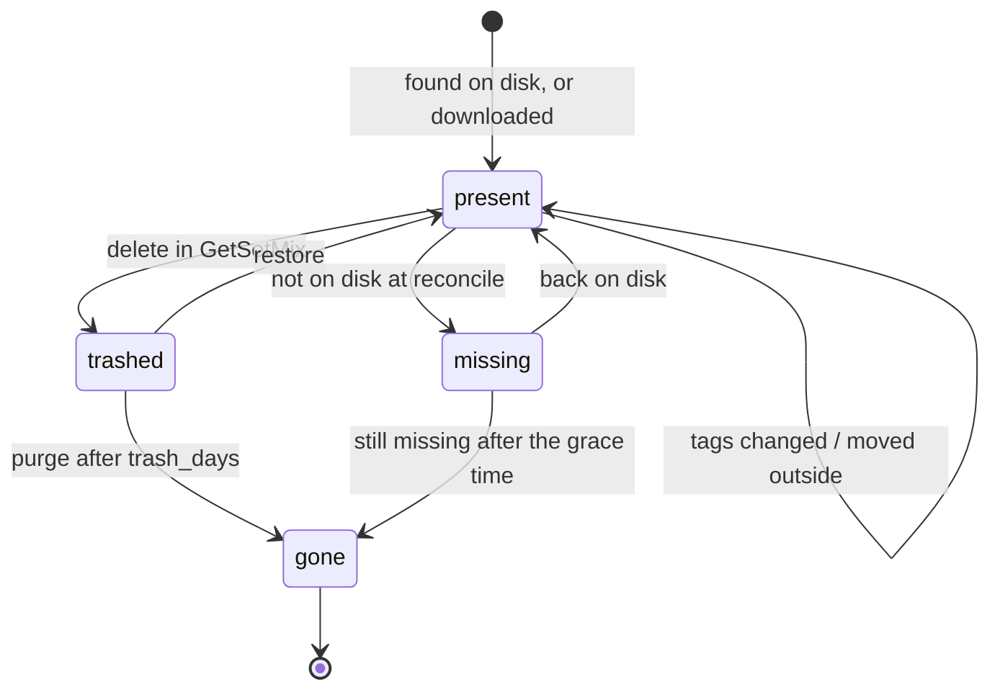
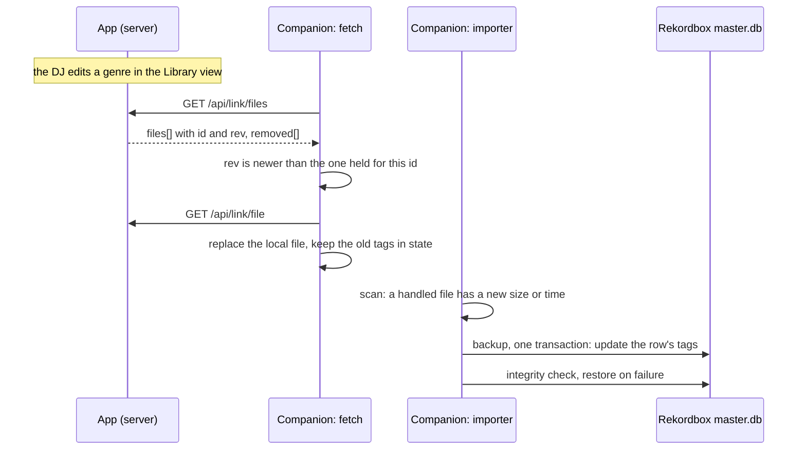

# Library module

| | |
|---|---|
| **Status** | **approved** by the maintainer on 2026-11-14. Two proposals stay open and are decided before the slice that needs them: 17 (fields with several values) and 18 (a full date when the year is edited); see [section 6](#6-decisions-and-open-questions) |
| **Issues** | design [#19](https://github.com/Fre0Grella/getsetmix/issues/19), feature [#11](https://github.com/Fre0Grella/getsetmix/issues/11), roadmap [#12](https://github.com/Fre0Grella/getsetmix/issues/12) |
| **Date** | 2026-11-13 |

System-level decisions are in the
[decision log](../architecture.md#9-decision-log) and are not repeated here.
This design rests on four of them: a track is identified by a hash of its
audio (decision 4), files are not renamed in this version (decision 5),
features run wherever the app runs (decision 3), and only components that
allow commercial use ship (decision 2). It adds no new dependency: tags are
read and written with mutagen, hashes come from the standard libraries.

The choices this draft proposed were reviewed with the maintainer and are
recorded under [Decisions and open questions](#6-decisions-and-open-questions).
What is still marked **Proposal** has not been decided.

The batch editing module ([`batch-editing.md`](batch-editing.md),
[#20](https://github.com/Fre0Grella/getsetmix/issues/20)) builds on this
one. What it needs from the Library is designed here, where it belongs: a
checked write of several fields, year and comment as editable fields, and
values indexed exactly as the file holds them.

## 1. Goals and non-goals

### Goals

- **A Library view** of every audio file under the library root, on a phone
  and on a desktop: search, sort, filter, play a preview.
- **Fix a track for good**: edit title, artist, album, genre, year,
  comment and cover, and have the edit reach the file, every paired computer
  and Rekordbox.
- **Delete, recoverably**: a delete moves the file to a trash folder, can be
  undone, and is purged after a set number of days.
- **Bulk actions** on a selection: delete, restore, set genre.
- **Computers follow, carefully**: a paired computer learns which tracks
  changed and which were deleted. It never deletes anything from Rekordbox
  on its own.
- **The same in local mode**: with no server, the view and the index work
  over the library on the DJ's computer.
- **A stable identity** per track that later modules (batch editing,
  analysis) can key their data on.

### Non-goals

- **Renaming or moving files.** Not from the template, not in bulk, not per
  track. A rename done *outside* GetSetMix is followed, not caused.
- **Batch rules** (case fixes, "feat." handling, find and replace). That is
  the batch editing module,
  [#20](https://github.com/Fre0Grella/getsetmix/issues/20).
- **Analysis** of any kind: BPM, key, similarity.
- **Online tag lookup and audio duplicates.** Out of the roadmap
  (decision 6).
- **Users and permissions.** The app stays single-user.
- **Two-way sync.** A computer still cannot change the server's library.

## 2. Where things stand

Checked against the code on 2026-11-13.

| Fact | Where |
|---|---|
| The app only knows tracks it downloaded. The `tracks` table is the download queue; *Clear finished rows* deletes ingested rows. | `app/db.py` |
| `/api/link/files` walks the disk on every request and returns `path`, `size`, `mtime` per file. Names starting with `.` or `~`, or ending in `.part` or `.tmp`, are skipped, folders included. | `app/link.py` |
| The worker tags a download in the temp folder and then moves it into the library root (since [#33](https://github.com/Fre0Grella/getsetmix/pull/33)). Nothing records the file in a table that outlives *Clear finished rows*. | `app/worker.py`, `_process` |
| The tagger writes MP3 (ID3v2.4) and FLAC only, always rewrites title, artist and comment, and is only ever called on a fresh download. | `app/tagger.py` |
| The link serves nine extensions: mp3, flac, m4a, aac, aif, aiff, wav, ogg, opus. | `app/link.py` |
| The companion imports seven of them. Ogg and Opus files are downloaded and then ignored, because Rekordbox cannot import them. | `companion/internal/audio/probe.go` |
| `fetched.json` maps a server path to the time it was fetched. A path in it is never fetched again. | `companion/internal/fetch` |
| `state.json` maps a local path key to the time the importer handled it. | `companion/internal/config` |
| The importer only inserts rows. It skips a file whose path is already in the collection. | `companion/internal/library/import.go` |
| The UI polls `/api/tracks` every 1.2 to 4 seconds and gets the whole list each time. Rows are reconciled by id; nothing is virtualised. | `app/static/app.js` |

## 3. Interfaces and data contracts

### 3.1 Track identity

A track's identity, its **audio id**, is a string:

```text
a1_3f9c0d2a7b1e4c5d8a6f0b9e2d7c1a45
```

| Part | Meaning |
|---|---|
| `a` | computed from the audio payload, so it survives tag edits, moves and renames |
| `1` | version of the algorithm; a change to the rules below makes it `a2` |
| 32 hex digits | the first 128 bits of the SHA-256 of the payload, lowercase |

A file whose container cannot be parsed gets a **fallback id**, `f1_` plus
the same 128 bits over the whole file. It is honest about being weaker: it
changes when anything in the file changes. Files with a fallback id are
listed and can be deleted, but their tags cannot be edited in GetSetMix, so
GetSetMix itself never changes their id.

The payload per container is defined in [4.2](#42-the-audio-hash).

### 3.2 The index

Two tables in `getsetmix.db`, next to the existing ones.

```sql
CREATE TABLE library_files (
    id               INTEGER PRIMARY KEY,      -- key used by the Library API
    path             TEXT    NOT NULL,         -- library-relative, "/"-separated; unique among
                                               -- present and missing rows (a partial index):
                                               -- a tombstone keeps its last path
    audio_id         TEXT    NOT NULL,         -- "a1_…" or "f1_…"
    size             INTEGER NOT NULL,         -- bytes, as last seen
    mtime_ns         INTEGER NOT NULL,         -- as last seen
    format           TEXT    NOT NULL,         -- "mp3", "flac", "m4a", …
    title            TEXT    NOT NULL DEFAULT '',
    artist           TEXT    NOT NULL DEFAULT '',
    album            TEXT    NOT NULL DEFAULT '',
    genre            TEXT    NOT NULL DEFAULT '',
    year             INTEGER,
    comment          TEXT    NOT NULL DEFAULT '',
    has_cover        INTEGER NOT NULL DEFAULT 0,
    multi            TEXT    NOT NULL DEFAULT '',  -- fields holding several values, e.g. "artist,genre"
    duration         REAL,                     -- seconds
    bitrate          INTEGER,                  -- kbps
    sample_rate      INTEGER,
    source_url       TEXT    NOT NULL DEFAULT '',  -- from the download, when known
    search           TEXT    NOT NULL,         -- lowercased, accents folded
    added_at         TEXT    NOT NULL,         -- when it was downloaded or first seen; in the
                                               -- first index, the file's own modification time
    rev              INTEGER NOT NULL,         -- change number of the last change
    content_rev      INTEGER NOT NULL,         -- change number of the last change of the
                                               -- file's bytes: the link's files[].rev (3.5)
    state            TEXT    NOT NULL DEFAULT 'present',
                     -- present | missing | trashed | gone
    state_changed_at TEXT,
    trash_path       TEXT                      -- set when trashed; kept after the purge, so a
                                               -- gone tombstone still says "deleted" (3.5)
);
CREATE INDEX library_files_audio ON library_files (audio_id);
CREATE INDEX library_files_state ON library_files (state, rev);

CREATE TABLE library_meta (
    key   TEXT PRIMARY KEY,   -- 'rev', 'last_reconcile', 'indexed', 'unavailable'
    value TEXT
);
```

- `rev` is one counter for the whole library. Every change to a row (new,
  tags changed, moved, trashed, restored, gone) takes the next value.
- `audio_id` is not unique. Two files with the same audio are two rows, and
  the view says so. The link lists only one of them (the oldest row), so a
  computer fetches the audio once.
- A row in state `trashed` or `gone` is a **tombstone**. It keeps the audio
  id, the last path and the time.
- **Tag columns hold the file's values exactly.** `title`, `artist`,
  `album`, `genre` and `comment` are stored as they are in the file: not
  trimmed, not case-folded, nothing normalised. Lowercasing and accent
  folding exist only in `search`. A caller that shows "the old value" of a
  field, as the batch editing preview does, shows what the file holds.
- `year` is the year of the file's date tag (`TDRC` in ID3, `date` in
  Vorbis comments), or empty.
- **Several values in one field** (**Proposal**, 17). A file can hold
  several values for a field: a multi-value `TPE1`, or several `ARTIST`
  comments in a FLAC. The index stores them joined with `"; "` in file
  order, and names the field in `multi`. Reading never changes the file. An
  edit of such a field writes the one value it was given; a field that is
  not edited keeps its several values.

### 3.3 Library API

All under `/api/library`, behind the same auth as the rest of `/api`.

| Method and path | Purpose |
|---|---|
| `GET /api/library` | list: search, filter, sort, paging |
| `GET /api/library/facets` | genres and folders with counts |
| `GET /api/library/status` | current `rev`, counts per state, last reconcile, `unavailable` flag |
| `POST /api/library/rescan` | reconcile now |
| `GET /api/library/{id}` | one file, all fields |
| `PATCH /api/library/{id}` | edit tags |
| `POST /api/library/{id}/cover` | replace the embedded cover (upload, or `{"url": …}`) |
| `GET /api/library/{id}/cover` | the embedded cover |
| `GET /api/library/{id}/audio` | the file, with range requests, for the preview |
| `DELETE /api/library/{id}` | move to trash |
| `POST /api/library/{id}/restore` | bring back from trash |
| `POST /api/library/bulk` | delete, restore or set genre on many |
| `DELETE /api/library/trash` | purge the trash now |

**List.** `GET /api/library?q=&genre=&folder=&state=present&sort=added&order=desc&limit=200&cursor=`

| Parameter | Values | Default |
|---|---|---|
| `q` | free text, matched against `search` (title, artist, album, genre, file name); every word has to match | none |
| `genre`, `folder` | exact match; `folder` is a library-relative directory and matches the files directly in it | none |
| `state` | `present`, `trashed` | `present` |
| `sort` | `added`, `artist`, `title`, `genre` | `added` |
| `order` | `asc`, `desc` | `desc` for `added`, else `asc` |
| `limit` | 1 to 500 | 200 |
| `cursor` | opaque, from the previous page's `next` | none |

```json
{
  "rev": 4812,
  "total": 3274,
  "next": "eyJrIjpbIjIwMjYtMTEtMTIiLDMxOV19",
  "items": [
    {
      "id": 319,
      "audio_id": "a1_3f9c0d2a7b1e4c5d8a6f0b9e2d7c1a45",
      "path": "Artist - Title.mp3",
      "format": "mp3",
      "title": "Title", "artist": "Artist", "album": "", "genre": "House",
      "year": null, "duration": 312.4, "has_cover": true,
      "size": 12518400, "added_at": "2026-11-12T21:04:10+00:00",
      "editable": true,
      "multi": [],
      "same_audio": []
    }
  ]
}
```

`editable` is false for formats the tagger cannot write and for fallback
ids. `multi` names the fields that hold several values in the file.
`same_audio` lists the ids of other files with the same audio id. The item
of `GET /api/library/{id}` also carries `comment`, `bitrate`, `sample_rate`
and `source_url`.

The query behind the list is one internal function,
`library.select(filter)`. Besides serving the pages above, it resolves a
filter (`q`, `genre`, `folder`, `state`) to the full set of matching ids,
each with its `editable` flag, without paging. The batch editing module uses
it to turn "everything matching this filter" into a selection.

**Edit.** `PATCH /api/library/{id}` with any of the fields below. Only the
fields sent are written; every other tag in the file stays as it is. All the
fields of one request are written in one step and take one `rev`.

| Field | Value |
|---|---|
| `title`, `artist`, `album`, `genre` | text; `""` clears the tag |
| `year` | an integer from 1000 to 9999, or `null` to clear it |
| `comment` | text; `""` clears the tag |
| `expect` | optional: an object with the values the caller believes some of these fields hold now |

```json
{ "genre": "Tech House", "year": 2019, "expect": { "genre": "tech-house" } }
```

With `expect`, the write happens only if every named field still holds the
given value in the file. If one differs, nothing is written and the answer
says which:

```json
{ "detail": "the file changed", "differs": { "genre": "House" } }
```

| Answer | When |
|---|---|
| `200` with the updated item | written, index updated, `rev` advanced |
| `400` | a value is not valid for its field (a year out of range) |
| `409` | the format is read-only in this version, or the id is a fallback id |
| `410` | the file is in the trash or gone |
| `412` | `expect` did not match; `differs` holds the file's current values |
| `423` | the file is in use (Windows, local mode, a deck has it loaded) |

`PATCH` is a thin caller of the internal write described in
[4.3](#43-editing-tags), which other modules call without HTTP.

**Bulk.** `POST /api/library/bulk`

```json
{ "ids": [319, 320, 512], "action": "set_genre", "genre": "Tech House" }
```

`action` is `delete`, `restore` or `set_genre`. The answer lists the outcome
per id, so one failure does not hide the rest:

```json
{ "done": [319, 512], "failed": [{ "id": 320, "status": 409, "detail": "read-only format" }] }
```

Once the batch editing module exists, `set_genre` creates one of its edits,
so a bulk genre change is previewed, journalled and undoable like every
other change to many tags. The request stays the same. Until then it works
as described here. Bulk delete and restore stay in this module either way.

**Settings.** One new setting, `trash_days` (`GSM_TRASH_DAYS`, default 30;
0 keeps the trash until it is purged by hand).

### 3.4 Tag fields per format

| Format | Listed and searchable | Tags read | Tags editable in this version | Delete |
|---|---|---|---|---|
| MP3 | yes | ID3v2 | **yes** (written as ID3v2.4) | yes |
| FLAC | yes | Vorbis comments | **yes** | yes |
| M4A | yes | MP4 atoms | no, read-only | yes |
| AIFF | yes | ID3 chunk | no, read-only | yes |
| WAV | yes | ID3 chunk, where present | no, read-only | yes |
| AAC (raw) | yes | none | no | yes |
| Ogg, Opus | yes | Vorbis comments | no, read-only | yes |

The worker only produces MP3 and FLAC, so everything GetSetMix downloaded is
editable. The read-only formats are files the DJ put in the library by other
means. mutagen can write M4A and AIFF; adding them is a later slice, once
their audio hash is covered by fixtures.

What an edit writes, per field:

| Field | MP3 (ID3v2.4) | FLAC (Vorbis comment) |
|---|---|---|
| Title | `TIT2` | `title` |
| Artist | `TPE1` | `artist` |
| Album | `TALB` | `album` |
| Genre | `TCON` | `genre` |
| Year | `TDRC` | `date` |
| Comment | `COMM` (language `eng`, empty description) | `comment` |
| Cover | `APIC` (type 3, front cover) | `PICTURE` block (type 3) |

- **Year.** The download path never writes a year, so today no downloaded
  file has one. When a file holds a full date (`2019-06-14`) and the year is
  not edited, the date is not touched. When the year is edited, the tag is
  written as the year alone (**Proposal**, 18).
- **Comment.** For a downloaded track the comment is
  `Source: <url> | via GetSetMix`, the only record of the track's origin
  inside the file. It is editable, but the detail sheet asks before it
  replaces a comment that holds a source link.
- **Other tags** (BPM, key, label, remixer, track number, anything a DJ app
  wrote) are never changed by an edit.

### 3.5 Link protocol 2

`GET /api/link/files` keeps its shape and gains fields. Old companions
ignore what they don't know.

```json
{
  "version": "1.9.0",
  "protocol": 2,
  "rev": 4812,
  "files": [
    {
      "path": "Artist - Title.mp3",
      "size": 12518400,
      "mtime": 1794517450,
      "id": "a1_3f9c0d2a7b1e4c5d8a6f0b9e2d7c1a45",
      "rev": 4790
    }
  ],
  "removed": [
    {
      "id": "a1_9b2e…",
      "path": "Other - Track.mp3",
      "at": "2026-11-12T22:10:03+00:00",
      "reason": "deleted"
    }
  ]
}
```

| Field | Meaning |
|---|---|
| `protocol` | `2`. Absent means protocol 1: the fields below are missing. |
| `rev` (top) | the library's current change number |
| `files[].id` | the audio id |
| `files[].rev` | the change number of the last time this file's bytes changed |
| `removed[]` | tombstones: tracks trashed in GetSetMix (`deleted`) or that vanished from the disk (`missing`) |

`GET /api/link/file?path=` is unchanged.

A companion does not download a file Rekordbox cannot import
(Ogg and Opus today), and its `status` says how many it skipped and why.
The server keeps listing them, so the Library view stays complete
([#31](https://github.com/Fre0Grella/getsetmix/issues/31)).

**Compatibility.**

| Companion | Server | Behaviour |
|---|---|---|
| old | new | Reads `path`, `size`, `mtime`, ignores the rest. Works as today: no changed tracks, no deletes. |
| new | old | No `protocol` field, so it works as today, keyed by path. |
| new | new | Full behaviour. |

Until the first index of an existing library is complete, a new server
answers as protocol 1, from a disk walk as today. A computer never waits for
the index.

### 3.6 The companion's state

`fetched.json` becomes version 2, keyed by audio id:

```json
{
  "version": 2,
  "tracks": {
    "a1_3f9c…": {
      "path": "Artist - Title.mp3",
      "rev": 4790,
      "at": "2026-11-12T21:10:00Z",
      "tags": { "title": "Title", "artist": "Artist", "album": "", "genre": "House",
                "year": 2019, "comment": "Source: https://… | via GetSetMix" }
    }
  },
  "legacy": { "Gone From Server.mp3": "2026-10-01T18:00:00Z" },
  "removed": { "a1_9b2e…": { "path": "Other - Track.mp3", "at": "2026-11-12T22:15:00Z",
                             "reason": "deleted" } }
}
```

| Key | Meaning |
|---|---|
| `tracks` | what this computer has fetched: the server path, the `rev` it holds, and the six tag fields it last saw (title, artist, album, genre, year, comment) |
| `legacy` | paths from the old file that the server no longer lists; kept so they are never fetched again if they come back |
| `removed` | tombstones already handled, for tracks this computer holds: the server path, when, the reason, and `recycle` / `recycled` for the opt-in local delete. The first draft held the time alone; that form still reads. Built in [#38](https://github.com/Fre0Grella/getsetmix/issues/38): the path is kept because a track known from `legacy` has no `tracks` entry to take it from |
| `skipped` | listed files of the last fetch that Rekordbox cannot import, counted by extension, for `status` |

While the server speaks protocol 1 the file stays version 1, so an older
companion can still read it.

`state.json` (which local files the importer has handled) stays keyed by
local path, since nothing is renamed. Its values grow from a time to
`{at, size, mtime}`, so the importer can tell that a handled file has
changed ([4.6](#46-what-a-computer-does)). It gains `removed`: the local
paths the importer has listed in the *removed on server* playlist, so none
is listed twice and a restore can take it out again.

## 4. Design

### 4.1 The index and how it stays true

The disk is the truth. The index is a cache of it that can be rebuilt at any
time.



**Reconcile** is one pass that brings the index in line with the disk:

1. Walk the library root with the same skip rules as the link (`.`, `~`,
   `.part`, `.tmp`), and skip files modified in the last 10 seconds, the
   settle time the companion already uses. A file in its settle time that
   already has a row is left as it is: not read again, not marked missing.
2. A path whose `size` and `mtime_ns` match its row is unchanged. Nothing is
   read. This is the common case and costs one `stat` per file.
3. A path with no row is hashed and its tags are read. If a row with the
   same audio id is `missing`, or its path vanished in this same pass, the
   file was moved or renamed outside GetSetMix: that row takes the new path.
   A move seen in one pass is therefore a move, not a delete and an add, and
   it does not count towards the guard below. Otherwise it is a new row.
4. A path whose size or time changed is hashed again. Same audio id: the
   tags changed outside GetSetMix; they are read again. Different audio id:
   the content was replaced. The old row becomes `gone` at once, with no
   grace time, and a new row is inserted.
5. A `present` row whose path is not on disk becomes `missing`. It becomes
   `gone` only when it is still missing after the grace time, 24 hours.
   Sync clients delete and recreate files while they update them, and a
   folder can be reorganised by hand over an evening; a day leaves room for
   both.
6. Every change takes the next `rev`.

**The guard.** If one pass would mark more than 20% of the library, and more
than 10 files, as missing, it marks none and sets `unavailable`. The size of
the library is the number of `present` rows before the pass. While the guard
is tripped nothing moves from `missing` to `gone` either. An unmounted
volume or a network share that dropped must never look like a mass delete.
The Library view shows a banner, and the next pass that does not trip the
guard clears it.

**The date a track was added.** A downloaded track is dated when the worker
places it. A file the index finds later is dated when it is first seen. The
first index of an existing library is the exception: every file would get
the same date, so each is dated by its own modification time and sorting by
"added" means something from the start.

**When it runs.**

| Trigger | Why |
|---|---|
| App start | catch what changed while it was off |
| Every 5 minutes | files added, changed or removed by Nextcloud, Syncthing or by hand |
| `/api/link/files`, if the last pass is older than 60 seconds | computers see new tracks as fast as today |
| `POST /api/library/rescan`, and opening the Library view | the DJ wants it now |
| The worker, directly | a finished download is inserted without a walk |

Passes never overlap; a trigger during a pass is dropped.

**The worker.** A download is tagged in the temp folder and then moved into
the library, so a computer never sees an untagged track. This design adds
the last step: the worker inserts the row right after the move, so the row
is there the moment the file is.

**First run over an existing library.** Every file is hashed once, in the
background, in batches committed as they go, so a restart resumes. The
Library view shows progress and lists what is indexed so far.

**Cost.** Estimated for 3,000 tracks of about 10 MB, then measured in the
first build slice ([#35](https://github.com/Fre0Grella/getsetmix/issues/35))
on a laptop with a local SSD.

| Operation | Work | Estimate | Measured |
|---|---|---|---|
| First index | read every file once, SHA-256, read tags | minutes; bound by the disk, not the CPU | a real library of 568 tracks, 6.3 GB: 12 s for the hashing (about 500 MB/s). 3,000 small generated files: 2.7 s, or 23 s when the files had just been written. |
| Reconcile, nothing changed | one `stat` per file | well under a second on a local disk, a few seconds on a network share | 45 ms for 3,000 files |
| Reconcile, one file changed | read and hash that file | tens of milliseconds | 29 to 57 ms |
| List with a search, 3,000 rows | one query | | 7 ms |
| Index size | one row per file | about 1 MB | 1.24 MB for 3,000 rows |

At that rate a 30 GB library indexes in about a minute from an SSD, and in a
few minutes from a hard disk or over a network. The first index of files
that were just copied is several times slower per file on Windows, most
likely the virus scanner reading each new file on first open (not
confirmed).

### 4.2 The audio hash

**Function.** SHA-256, truncated to 128 bits, lowercase hex. It is in the
standard library of both Python and Go, so there is no new dependency for
the image, the executables or the companion. It is hardware-accelerated on
amd64 and on most arm64 chips. Collision resistance is not needed for an
identity, but it costs nothing. 128 bits keeps the id short and leaves the
chance of two different tracks sharing one beyond any practical concern.

**Input.** The bytes of the audio payload, in file order, as defined per
container below. Nothing else is mixed in.

| Container | Payload |
|---|---|
| **MP3** | From the first audio frame to the end of the audio. Leading ID3v2 tags and trailing ID3v1, Lyrics3v2 and APEv2 tags are left out. |
| **FLAC** | Everything after the last metadata block: the audio frames. |
| **WAV** | The payload of the `fmt ` chunk, then the payload of the `data` chunk. |
| **AIFF** | The payload of the `COMM` chunk, then the payload of the `SSND` chunk. |
| **MP4 / M4A** | The payload of every top-level `mdat` atom, in file order. |
| **Ogg, Opus** | The packets of the stream, without the comment packet. Specified here, built later. |

The rules, exact enough to implement twice:

**MP3**

1. *Start.* While the bytes at the current position are `ID3`, skip an
   ID3v2 tag: 10 bytes of header, the syncsafe size in bytes 6 to 9, and 10
   more if the footer flag (bit 4 of byte 5) is set. This covers the tag's
   own padding, which is inside its size.
2. From there, scan forward up to 1 MiB for the first **valid frame**: a
   4-byte header with the 11 sync bits set, a version other than reserved,
   Layer III, a bitrate index other than 0 and 15, a sample-rate index other
   than 3, and, at the offset the frame's length gives, either the end of
   the payload or another header with the same version, layer and sample
   rate. Junk between the tag and the audio is thereby left out.
3. *End.* Repeat until none applies: drop a trailing ID3v1 tag (the last 128
   bytes start with `TAG`); drop a Lyrics3v2 block (ends with `LYRICS200`,
   preceded by its 6-digit size); drop an APEv2 tag (the last 32 bytes start
   with `APETAGEX`; its size field, plus 32 when the header flag is set).
4. Hash from the start to the end.

The Xing, Info or LAME header frame is the first audio frame and **is
hashed**. It is part of the stream, and tag editors leave it alone.

**FLAC**

1. Skip a leading ID3v2 tag if a broken tagger put one there.
2. Expect `fLaC`. Walk the metadata blocks by their 4-byte headers until the
   one with the last-block flag.
3. Hash from the end of that block to the end of the file.

Padding, pictures and comments are metadata blocks, so adding a cover or
growing the padding changes nothing.

**WAV.** Walk the RIFF chunks. Hash the `fmt ` payload, then the `data`
payload, without their headers and pad bytes. `LIST` and `id3 ` chunks are
left out. RF64 and Wave64 get the fallback id.

**AIFF.** Walk the FORM chunks (`AIFF` or `AIFC`). Hash the `COMM` payload,
then the `SSND` payload. The `ID3 ` chunk is left out.

**MP4.** Walk the top-level atoms, with 64-bit sizes and size 0 handled as
the companion's probe does today. Hash the payload of each `mdat`. Tags live
under `moov`; a tag edit can move `mdat` in the file and rewrite the chunk
offsets in `moov`, but the bytes inside `mdat` stay the same.

**Ogg and Opus.** Raw pages cannot be hashed: a comment edit renumbers the
pages that follow and changes their checksums. The rule is to rebuild the
packets from the pages of the first stream and hash every packet except the
second, which is the comment packet in both Vorbis and Opus. A chained file
gets the fallback id. This is not built in the first version.
Rekordbox cannot import these files, the worker never produces them, and
they are read-only in the Library view, so the fallback id serves them until
they matter.

**Anything else, and anything damaged.** A file that does not parse by its
rule gets the fallback id, `f1_` over the whole file. Nothing is guessed.

**Details the first implementation settled.** They are written into the
code and into `testdata/audiohash/README.md`, so the Go side matches:

- The container is chosen by the file extension (`.m4a` and `.mp4` are MP4,
  `.aif` and `.aiff` are AIFF).
- An empty payload gets the fallback id.
- An ID3v2 size byte with its top bit set means the file does not parse.
- A chunk or atom that runs past the end of the file means the file does not
  parse; fewer than 8 stray bytes at the end are ignored.
- The frame after the first MP3 frame must have the sync bits and the same
  version, layer and sample rate. Its bitrate is not checked.
- The first `fmt ` and `data` chunk, and the first `COMM` and `SSND` chunk,
  are the ones used.
- A file cut short in the middle of its audio still parses: it gets an `a1_`
  id, different from the whole file's. Only a file cut in its header or tag
  region gets the fallback id. Either way nothing raises.

**When it is computed, and the cache.** A hash is computed when a file is
first seen and whenever its size or modification time differ from the row.
The row *is* the cache: `(path, size, mtime_ns) → audio_id`. An edit made by
GetSetMix does not rehash: the payload is known not to have changed, and the
row is updated with the file's new size and time directly.

**Two implementations, one answer.** Python in `app/audiohash.py`, Go in
`companion/internal/audio/hash.go`. They are kept equal by shared fixtures
([5](#5-testing)).

**Hard cases.**

| Case | What happens | Judgement |
|---|---|---|
| A tag edit grows the tag past its padding, so the whole file is rewritten | The payload bytes are the same; the id holds. | this is the case the design exists for |
| A tool re-encodes the file, or converts MP3 to FLAC | New audio bytes, new id. | correct: it is a different file; analysis must not carry over blindly |
| A tool changes the audio frames without re-encoding (mp3gain's volume field, "fix VBR header") | New id. | accepted; such tools are rare in a DJ library. The track shows up as one removed and one added. |
| A tag appended at the end in a form not listed above | Counted as audio; the id changes if that tag is later edited. | accepted; mutagen does not write such tags |
| Two files with the same audio and different tags | Same id, two rows. | intended: the view flags them, a computer fetches one |
| FLAC whose frames are re-compressed at another level | New id, although the sound is identical. | see the alternative in [7](#7-alternatives-considered) |

### 4.3 Editing tags

The tagger gains an edit path beside the download path. It differs in two
ways:

- **Only the fields sent are written.** The download path rewrites title,
  artist and comment every time; an edit must leave the comment, the cover
  and every tag it was not asked about untouched.
- **The write is atomic.** The file is copied under a hidden name
  (`.<name>.part`, already skipped by the link and by the companion's
  scanner), the copy is tagged, and it replaces the original in one rename.
  A crash leaves the old file intact, and a computer can never fetch half a
  file. It costs one copy of the file per write, however many fields the
  write changes.

**One internal write.** All tag edits go through one function in the
Library module, callable without HTTP:

```python
library.write_tags(file_id, changes, expect=None) -> WriteResult
```

| Argument | Meaning |
|---|---|
| `changes` | any set of the six fields (title, artist, album, genre, year, comment) with their new values |
| `expect` | optional: the values the caller believes some fields hold now |

1. Read the fields named in `expect` from the file itself, not from the
   index. If one differs, stop: nothing is written, and the result names the
   fields that differ with the values the file holds.
2. Copy, tag the copy with every change, rename it over the original.
3. Update the row (tags, size, time) and take **one** `rev` for the whole
   write.

The result holds the new row, or the mismatch. `PATCH /api/library/{id}` is
a thin caller. The batch editing module calls the function directly, once
per track, with the old values its preview showed as `expect`; a batch
therefore copies each file once, not once per field, and only overwrites
what the DJ saw.

The audio id is unchanged by construction. When the tests run, they also
check it by rehashing.

**The cover** goes the same way, through
`library.write_cover(file_id, image_or_none)`, with the existing cover
search and upload in front of it. The function returns the image it
replaced, or says there was none, so a caller that keeps a journal can undo
a cover change. `POST /api/library/{id}/cover` does not return the old
image.

### 4.4 Deleting, the trash and tombstones

- **Delete** moves the file to
  `<library>/.trash/<UTC time>-<id>/<original relative path>`. The folder
  starts with a dot, so the link, the reconcile walk and the companion's
  scanner already ignore it. It is on the same volume, so the move is a
  rename. The row becomes `trashed`, keeps its path in `path` and the new
  location in `trash_path`, and takes the next `rev`.
- **Restore** moves it back to its original path and makes the row `present`
  again. If another file has taken that path meanwhile, the restore is
  refused with `409` and the DJ decides. Nothing is renamed to make room.
- **Purge** runs once a day and on demand. It deletes trash folders older
  than `trash_days` and turns their rows to `gone`.
- **A tombstone** is a row in state `trashed` or `gone`. It is what
  `removed[]` in the link listing is built from. Tombstones are kept for
  good. A paired computer can be off for months and must still
  learn of a delete when it comes back; the rows are tiny.

A file that vanishes without GetSetMix (deleted in the Nextcloud app, or by
hand) becomes `missing`, then `gone` after the grace time, and is listed in
`removed[]` with reason `missing`. That answers #11's first open question
with its own "probably yes": **a delete made outside GetSetMix counts as a
server delete**, with the grace time and the guard of [4.1](#41-the-index-and-how-it-stays-true)
as the safety. There is no trash to restore from in that case, and the view
says so.

**As built** ([#38](https://github.com/Fre0Grella/getsetmix/issues/38)):

| Request | Answer |
|---|---|
| `DELETE /api/library/{id}` | `200` with `{id, state: "trashed", rev}`; `404` unknown id; `410` already trashed or gone; `409` the row is `missing` (nothing on disk to move) |
| `POST /api/library/{id}/restore` | `200` with `{id, state: "present", rev}`; `404`; `409` not in the trash, or its path is taken by a file on disk or a live row; `410` purged, or the file in the trash has vanished (the row then becomes `gone`) |
| `DELETE /api/library/trash` | `200` with `{purged: n}`: the whole trash, whatever its age |

- The row is updated and the file moved in one database transaction: if the
  move fails, the row rolls back. A restore keeps `content_rev`, and the
  rename keeps the file's time, so a paired computer does not download it
  again. The empty `<UTC time>-<id>` folder is removed after a restore.
- The purge only deletes `<UTC time>-<id>` folders of trashed rows; anything
  else in `.trash/` is left alone. A folder it cannot delete stays, with its
  row `trashed`, and is tried again the next day.
- `trash_days` 0 means no purge by age: the trash keeps everything until
  *Empty trash*. The daily purge runs with the 5-minute pass, at most once
  per 24 hours (`last_purge` in `library_meta`).
- Routes that take an id use the `int` path convertor, so `/api/library/trash`
  and `/api/library/rules` are never read as an id.

### 4.5 The Library view

One more place in the app, beside the download list. A switch in the top
bar moves between **Downloads** and **Library**.

**On a phone**

- A list of rows: cover, title, artist, a genre chip.
- **Search sits at the bottom**, where the link field is in the download
  view, so it is under the thumb. Typing filters as it goes, with a short
  debounce.
- Genre chips above the list filter with one tap. A sort menu holds added,
  artist, title and genre.
- Tapping a row opens a sheet: the fields (title, artist, album, genre,
  year, comment), the same one-tap genre picks as in the download view,
  cover, preview player, delete. The comment is shown with its source link;
  the sheet asks before it replaces one.
- A long press starts a selection. A bar then offers *Delete* and
  *Set genre*, with the count.

**On a desktop**

- The same data as a table, edited in place like the download rows.
- Click, Shift-click and Ctrl-click select; the same bulk bar appears.
- A folder filter sits beside the genre filter.

**Both**

- A **Trash** entry lists trashed tracks with *Restore* and *Empty trash*.
- Read-only rows say why (format, or damaged file).
- Rows that share their audio with another file carry a small marker.
- English and Italian, light and dark, as the rest of the UI.

**Long lists.** The list is **virtualised**: rows have a fixed height, and
only the visible ones plus a margin are in the page. Data comes in pages of
200 from the API as the list is scrolled. The view does not poll the list;
it polls `/api/library/status` and reloads what is on screen when `rev`
moves. That answers #11's fourth open question.

**Delete confirmation.** One track: an *Undo* toast, no dialog. A selection:
a dialog with the count. No confirmation phrase: a delete is recoverable for
`trash_days`.

### 4.6 What a computer does

The rule that a computer never changes the server stays. So does the rule
that a delete on the computer sticks.



**A changed track** (the listing's `rev` for an id is newer than the one in
`fetched.json`):

1. If the local file is no longer there, the DJ removed it. Record the new
   `rev` and do nothing else. Deleting on the computer still sticks.
2. Otherwise download to `.part` and rename over the local file, as a new
   track is downloaded today. The audio hash of the download is checked
   against the id.
3. The importer's next sync sees that a file it has handled changed size or
   time. It reads the tags from the file and compares them with the tags
   remembered in `fetched.json`.
4. For the row with that path, under the importer's safety (Rekordbox
   closed, backup, one transaction, integrity check, restore on failure):

| Column | Change |
|---|---|
| `Title` | new value, if the title changed on the server |
| `ArtistID`, `AlbumID`, `GenreID` | the id of the row with that exact name, created when missing, as an import does |
| `ReleaseYear` | new value, if the year changed on the server; empty when it was cleared |
| `Commnt` | new value, if the comment changed on the server |
| `FileSize` | the file's new size |
| `rb_file_id` | the file's new filesystem id, since the file was replaced |
| `updated_at`, `rb_local_usn` | now, and the next change number |
| `agentRegistry.localUpdateCount` | the last change number used |

   Nothing else in the row is touched. Cues, the beat grid, the analysis
   path, ratings, play counts and playlist entries hang off the row's `ID`,
   which does not change.

5. **Only fields that changed on the server are written.** If the DJ changed
   the artist in Rekordbox and the server changed the genre, the artist in
   Rekordbox is kept. If both changed the same field, the server's value
   wins.
6. If no row has that path, the DJ removed the track from Rekordbox. It is
   not imported again.

**A deleted track** (an id in `removed[]` not yet in the state's `removed`):

1. The row is added to a root playlist, **GetSetMix: removed on server**,
   created when missing, with the same playlist code and the same
   `masterPlaylists6.xml` mirror as the import playlist. A track is never
   added twice.
2. Nothing is removed from the collection. Removing a track would also lose
   its cues, grid and playlist entries; that decision is the DJ's.
3. With the option *Delete the local file too* (off by default) the local
   file goes to the system's recycle bin, so even that is
   recoverable. Without the option the file stays.
4. If the id is listed again later (a restore), the track is taken out of
   that playlist.

Both need a write to `master.db`, so both wait while Rekordbox is open, as
imports do.

**As built** for deleted tracks ([#38](https://github.com/Fre0Grella/getsetmix/issues/38)):

- *Fetch* owns `fetched.json`. It records a tombstone only for a track this
  computer holds (in `tracks`, or by path in `legacy`), drops it when the id
  is listed again, and does the opt-in local delete. It never opens
  `master.db`.
- *The importer* reads `fetched.json` without writing it and compares its
  tombstones with the paths it has listed (`state.json`, `removed`). The
  difference is written in the same sync as the imports, under the same
  backup, after the imports, so a track fetched and removed while Rekordbox
  was open has its row by then. Nothing to list means `master.db` is not
  opened. A path with no row in the collection (the DJ removed it) is
  recorded as handled and not looked for again.
- Taking a track out of the playlist deletes its `djmdSongPlaylist` row in
  that playlist only and renumbers the rest, each moved entry with the next
  change number, as pyrekordbox does.
- *Delete the local file too* is `"delete_removed_files": true` in the
  `server` entry of `companion.json`; Setup does not offer it yet. It acts
  on tombstones handled while it is on, never on older ones. Windows: the
  Recycle Bin through `SHFileOperationW` with undo, only on a fixed drive
  (a network share or a USB stick has no bin and Windows would delete for
  good), and asking rather than deleting if the bin is turned off. macOS:
  the Finder moves it to the Trash, which asks once for permission to
  control the Finder. A failed move leaves the file and is tried again on
  the next fetch. If the track is restored on the server and its file went
  to the bin, it is downloaded again.
- The "handled file is gone" rule for local mode and synced folders is slice
  7; without a paired server nothing is listed.

**Folders filled by a sync client.** When Setup was told *My server's music
folder is already synced here*, there is no fetch. Nextcloud or Syncthing
replaces a changed file itself, and the importer's scan picks the change up
by size and time, as in step 3. Without a paired server the importer has no
remembered tags to compare with, so it writes all six fields (title,
artist, album, genre, year, comment).
Deletes arrive as files that vanish; see local mode below.

**Migration of `fetched.json`**, on the first fetch against a protocol 2
server:

1. For each listed file whose path is in the old map: record its id. If the
   local file has the listed size, record the listed `rev`. If not, record
   `rev` 0, so it counts as changed and is fetched again.
2. Old paths the server no longer lists go to `legacy`.
3. The old file is kept as `fetched.v1.json`.

`state.json` values are widened in place on the first sync: each handled
path gets the size and time the file has at that moment, and nothing is
acted on.

### 4.7 Local mode

With no server the app runs on the DJ's computer and the library root is a
folder the companion watches. The same index, the same API and the same view
work over it. There is no link and no fetch; the file system carries the
news.

| In the Library view | On the same machine |
|---|---|
| Edit tags | The file is replaced in place. The importer's next sync, right before Rekordbox starts, sees the change and updates the row. |
| Delete | The file moves to `.trash/`. The importer sees that a file it handled is gone while its row is still in the collection, and adds the row to the *removed* playlist. Rekordbox shows the track as missing until the DJ removes it or the file is restored. |
| Restore | The file is back at its path. The row works again, and the track leaves the *removed* playlist. |

An edit can fail with `423` when Rekordbox has the file loaded on a deck.
The view says to unload it and try again.

The "handled file is gone" rule is used in local mode and for synced
folders only. With a paired server a missing local file means the DJ
deleted it on purpose, and the tombstone from the server is what counts.

### 4.8 Who may delete

Anyone who can open the UI can edit and delete, as they can change every
setting today. That fits one DJ on a home server, and a delete is
recoverable. Link tokens open `/api/link` only, so a paired computer cannot
delete. A hosted offering for several people needs real users and
permissions; that is a
[risk in the architecture document](../architecture.md#10-risks-and-technical-debt),
not something this module solves.

## 5. Testing

| Layer | What is tested |
|---|---|
| **Hash fixtures, both languages** | `testdata/audiohash/` holds small audio files of a few kilobytes and `expected.json`. For each file it gives the expected id; for each group it lists files that must share an id (the same audio with no tags, ID3v2.3, ID3v2.4, ID3v1, APEv2, a cover, grown padding, `moov` before and after `mdat`, extra RIFF chunks) and files that must differ. `tests/test_audiohash.py` and `companion/internal/audio/hash_test.go` read the same folder, so the two implementations cannot drift. A script next to the fixtures records how they were made. |
| **Hash properties** | Edit every tag field with the tagger and with the edit path: the id holds. Truncate or corrupt a file: fallback id, no exception. |
| **Index and reconcile** (pytest, `tmp_path`) | New, changed, moved, missing and back, gone after the grace time, the 20% guard, the settle time, resume after an interrupted first index. |
| **Edit path** (pytest, on fixture files) | A write changes only the fields it was given: every other tag, the cover and the audio id are the same before and after. Several fields in one call make one copy and take one `rev`. Year and comment are written to the right frame per format; a full date is left alone when the year is not edited. With `expect`, a mismatch writes nothing and names the fields that differ. `write_cover` returns the image it replaced. A field with several values is indexed joined, listed in `multi`, and kept when another field is edited. Index columns hold the file's values unfolded. |
| **Library API** (pytest, as `tests/test_api.py`) | List with search, filters, sorts and paging; `library.select` returns every matching id with its `editable` flag; edit per format, including year and comment; the `400`, `409`, `410`, `412` and `423` answers; delete, restore, purge; bulk with a partial failure. |
| **Link protocol** (pytest and Go) | The listing's new fields; an old companion's reading of a new listing; a new companion against an old listing; trashed files are neither listed nor served. |
| **Companion** (Go, with the `librarytest` fixture) | State migration; a changed track updates exactly the columns in [4.6](#46-what-a-computer-does) and leaves cues and playlist rows alone; a deleted track lands in the playlist once; a restore removes it; a locally deleted file is not fetched again; everything is refused while Rekordbox runs; the backup is restored when the check fails. |
| **UI** | The virtualised list with a few thousand rows on a phone-sized viewport; selection and bulk bar; both languages. |

**Manual checklist against a real Rekordbox**, on a copy of a library,
before the companion slices ship:

- [ ] Edit title, artist, album, genre, year and comment on the server;
      after fetch and launch the row shows them.
- [ ] That track keeps its hot cues, memory cues, beat grid, rating and its
      place in every playlist.
- [ ] Rekordbox does not flag the file as missing and does not ask to
      analyse it again, with the file replaced and `rb_file_id` updated.
- [ ] What Rekordbox shows for the cover after a cover edit, with and
      without *Reload Tag*.
- [ ] The *removed on server* playlist appears, with the right tracks, and
      survives a Rekordbox restart.
- [ ] A USB export of an edited track works and carries the new tags.
- [ ] The same with Cloud Library Sync on, if available.

**Delete and restore** ([#38](https://github.com/Fre0Grella/getsetmix/issues/38)),
by the maintainer, on a **copy** of a Rekordbox library (never the one for a
gig), with Rekordbox closed while the companion syncs:

- [ ] Delete two fetched tracks in the Library view, run
      `gsm-companion fetch`, open Rekordbox: a root playlist
      *GetSetMix: removed on server* holds exactly those two tracks.
- [ ] Both tracks are still in the collection with their hot cues, memory
      cues, beat grid and their place in every other playlist.
- [ ] Quit and reopen Rekordbox: the playlist is still there, with the same
      tracks (the `masterPlaylists6.xml` mirror agrees with `master.db`).
- [ ] Fetch again: neither track is listed twice.
- [ ] Restore one in the Trash view, fetch, open Rekordbox: it has left the
      playlist and plays as before; the other is still listed.
- [ ] With Rekordbox open, delete a track and fetch: nothing changes until
      Rekordbox is closed and the launcher or the next fetch runs.
- [ ] With `"delete_removed_files": true` (on a test folder): a deleted
      track's local file is in the Recycle Bin (Windows) or the Trash
      (macOS, after allowing control of the Finder), and Rekordbox shows it
      as missing, still in the playlist.

## 6. Decisions and open questions

Decided with the maintainer on 2026-11-14. The first four were discussed one
by one; the rest were accepted as proposed.

| # | Question | Decision |
|---|---|---|
| 1 | Grace time before a file that vanished outside GetSetMix counts as deleted | **24 hours** (the draft proposed 15 minutes; the maintainer asked for longer) |
| 2 | The guard against mass deletes | no tombstones when more than 20% and more than 10 files go missing in one pass |
| 3 | Server and Rekordbox both changed the same field | the server's value wins |
| 4 | Where the trash lives | inside the library root, `<library>/.trash/`. A library synced by Nextcloud or Syncthing carries it along when hidden files are synced. |
| 5 | Exact duplicates (same audio, two files) | two rows, flagged in the view; a computer fetches one |
| 6 | Id format | `a1_` plus 128 bits of SHA-256 in hex; `f1_` for the fallback |
| 7 | Ogg and Opus hashing | specified, not built in the first version; fallback id until then |
| 8 | FLAC: hash the frame bytes, or use the MD5 in STREAMINFO | the frame bytes |
| 9 | How often to reconcile | every 5 minutes, plus the triggers in 4.1 |
| 10 | How long tombstones are kept | for good |
| 11 | Synced-folder mode with no paired server | every tag field the companion handles is written on a change (six, with year and comment) |
| 12 | "Handled file is gone" as a delete signal | local mode and synced folders only |
| 13 | Search | a folded `search` column matched with `LIKE`; SQLite full-text search if it proves too slow |
| 14 | Editing M4A and AIFF | a later slice |
| 15 | *Delete the local file too*: where the local file goes | the system's recycle bin, not a hard delete |
| 16 | Files Rekordbox cannot import (Ogg, Opus) | the companion skips them and says so; the server keeps listing them ([3.5](#35-link-protocol-2), [#31](https://github.com/Fre0Grella/getsetmix/issues/31)). Decided after approval, on 2026-11-14. |

Added on approval, from what the batch editing module needs
([its section 3.7](batch-editing.md#37-what-this-module-needs-from-the-library-module)):

| Addition | Where |
|---|---|
| One internal write of several fields, atomic, one `rev`, with an optional check of the old values | [3.3](#33-library-api), [4.3](#43-editing-tags) |
| Year and comment are editable and reach Rekordbox (`ReleaseYear`, `Commnt`) | [3.3](#33-library-api), [3.4](#34-tag-fields-per-format), [3.6](#36-the-companions-state), [4.6](#46-what-a-computer-does) |
| The cover write returns the image it replaced | [4.3](#43-editing-tags) |
| A filter resolves to ids with their `editable` flag | [3.3](#33-library-api) |
| Tag values are indexed exactly as the file holds them | [3.2](#32-the-index) |
| A rule for fields with several values | [3.2](#32-the-index), proposal 17 |
| Bulk *set genre* goes through batch editing once it exists | [3.3](#33-library-api) |

Still a proposal:

| # | Question | Proposed here |
|---|---|---|
| 17 | A field that holds several values in the file | the index shows them joined with `"; "` and names the field in `multi`; an edit of that field writes one value; a field that is not edited keeps its values ([3.2](#32-the-index)). Needed by slice 1 for reading and slice 3 for writing. |
| 18 | A full date in the file when the year is edited | the date is left alone unless the year is edited; then the tag is written as the year alone ([3.4](#34-tag-fields-per-format)). Needed by slice 3. |

Still open, with no proposal:

- **Does Rekordbox accept a changed `rb_file_id` and `FileSize` silently?**
  The manual checklist answers it. If not, the alternative is to write the
  download into the existing file instead of replacing it, which keeps the
  filesystem id and gives up the atomic rename.
- **What does Rekordbox do with the cover** of a track whose file changed?
  Its artwork is cached in its own files. This version does not touch them.
- **Changing the library root in Settings.** Every row vanishes at once, so
  the guard trips and stays tripped, while the files under the new root are
  indexed as new rows. It needs a rule: most likely, a changed root starts a
  fresh index. Found while building the first slice.

#11's open questions, for the record:

| #11 asks | Answer |
|---|---|
| Does a delete made outside GetSetMix count? | Yes, after a grace time and behind the guard ([4.4](#44-deleting-the-trash-and-tombstones)). |
| Identity across renames | The audio hash ([decision 4](../architecture.md#9-decision-log), [4.2](#42-the-audio-hash)). |
| Who may delete | Anyone who can open the UI; no phrase, since deletes are recoverable ([4.8](#48-who-may-delete)). |
| Long lists on a phone | A virtualised list, paged data, search under the thumb ([4.5](#45-the-library-view)). |

## 7. Alternatives considered

| Alternative | Why not |
|---|---|
| **An id written into a tag** | Every existing file has to be rewritten once, a copied file carries the same id as its source, another tagger can strip it, and formats without tags have nowhere to put it. Rejected in [decision 4](../architecture.md#9-decision-log). |
| **The path as identity** | What exists today. A rename outside GetSetMix looks like a delete plus a new track, and a result computed on the computer cannot be tied to the server's copy with certainty. |
| **A hash of the whole file** | Changes with every tag edit, which is the main thing this module does. Kept only as the fallback for files that do not parse. |
| **FLAC's own MD5 in STREAMINFO** | Free to read, and it survives re-compression. But some encoders leave it zero, it is trusted without checking, and it would make FLAC the one format whose id is not a hash of bytes read. It stays an option for an `a2`. |
| **An audio fingerprint (Chromaprint) as identity** | It is fuzzy by design: two masters of one track can match. An identity has to be exact. Also out of the roadmap. |
| **A filesystem watcher instead of a periodic reconcile** | Events are not delivered reliably through Docker bind mounts, network shares and every platform the app runs on. A walk that only calls `stat` is cheap and always right. A watcher can be added later as a hint that triggers a pass sooner. |
| **Hard delete** | One wrong tap on a phone would destroy the backup copy. |
| **Removing deleted tracks from Rekordbox automatically** | Loses cues, grids and playlist entries without asking. |
| **Sending tag changes to the computer as data, without the file** | The local file would keep the old tags, and Rekordbox's *Reload Tag* would bring them back. The companion would also need a tag writer in Go. |
| **Loading the whole list in the page** | Works at a few hundred tracks, not at a few thousand on a phone. |

## 8. Build slices

Thin slices, each working end to end, in the order they would be built.
Each slice is an issue under
[#11](https://github.com/Fre0Grella/getsetmix/issues/11).

1. **Index and a read-only Library list.** The tables, the Python audio hash
   with its fixtures, reconcile with the guard, the worker inserting the row
   after it places a file, `GET /api/library` and a plain list in the UI
   with search. Measures the costs estimated in 4.1.
2. **Link protocol 2.** `id`, `rev` and `removed[]` in the listing, served
   from the index. The Go audio hash against the shared fixtures. The
   companion reads protocol 2 and migrates `fetched.json`; its behaviour
   does not change yet, except that it stops downloading files Rekordbox
   cannot import.
3. **Edit one track, all the way.** The tagger's edit path and the
   internal write with its check of old values, `PATCH` for the six fields,
   the detail sheet, and on the computer: re-download, the importer's change
   detection, the update of the Rekordbox row. Ends with the manual
   checklist.
4. **Delete and restore, all the way.** Trash, restore, purge, tombstones,
   the Trash view, and on the computer the *removed on server* playlist and
   the opt-in local delete.
5. **Selection and bulk actions.** Bulk delete, restore and set genre, with
   the selection UI on phone and desktop.
6. **The full view.** Virtualised list, facets and filters, sorts, preview
   player, cover edit, duplicate markers.
7. **Local mode and synced folders.** The "handled file is gone" rule, the
   `423` path, Setup's wording.
8. **More formats.** M4A and AIFF editing; the Ogg and Opus hash, if
   wanted.
